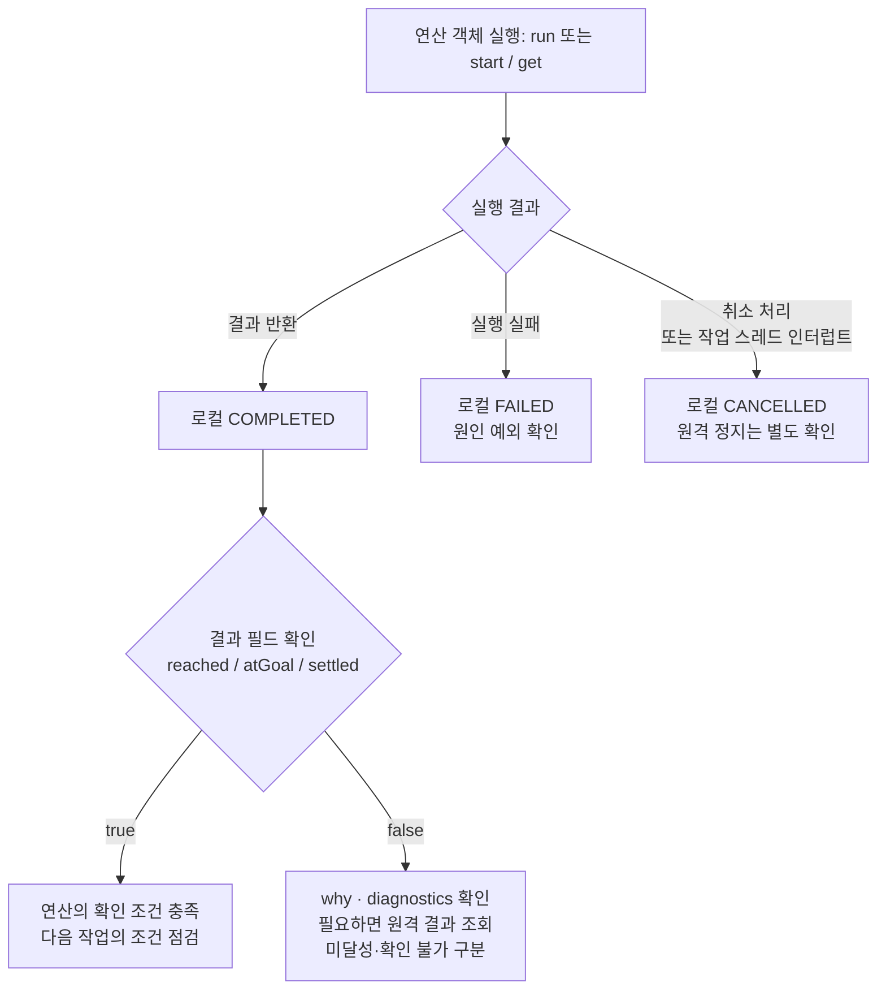
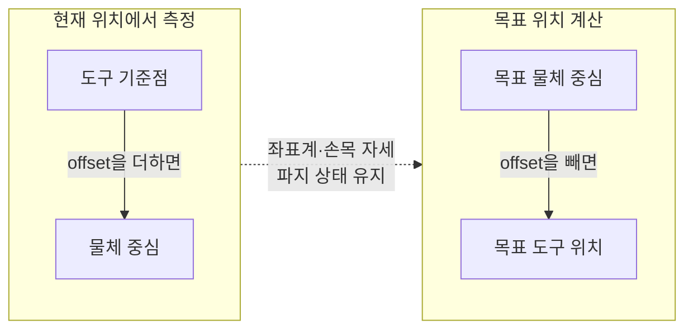
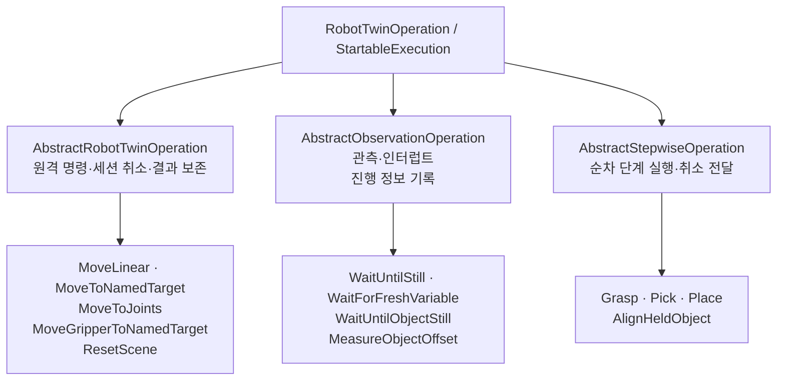

# mdt-robot-client (Java)

`mdt-robot-client`는 Java에서 rdfp_ws의 로봇 트윈 서버(`robot_twin` REST 게이트웨이)에
접속해 로봇을 제어하고 상태를 조회하는 라이브러리다. 파이썬
[`robot-twin-client`](../../mdtpy/robot-twin-client)의 클라이언트, 좌표 계산, 기본 연산을 바탕으로 만들었다.
HTTP 통신에는 `utils.rpc.restful`을, 실행 상태 관리와 비동기 결과 대기에는 `utils.async`를 사용한다.

팔과 그리퍼 이동, 장면 초기화, 상태 갱신 확인, 물체 오프셋 측정 등을 각각의 연산 객체로 제공한다.
여러 이동과 그리퍼 조작을 묶은 `Grasp`·`Pick`·`Place`도 사용할 수 있다.
이 문서에서 **정착 확인**은 관측값이 일정 시간 동안 허용 범위 안에 머무는지 확인하는 것을 뜻한다.

물체 선택, 작업 경로 계산, 쌓기나 peg 삽입의 전체 절차는 이 연산들을 조합해 구현한다.
데이터 수집 워크플로와 MCP 서버는 이 프로젝트의 제공 범위에 포함되지 않는다.
다만 서버의 수집 세션·에피소드 연산은 `RobotTwinClient.run()`으로 호출할 수 있다.
사용법은 `SessionEpisodeExample`을 참고한다.

## 문서 안내

- [1. 빌드](#1-빌드) · [2. 빠른 시작](#2-빠른-시작) · [6.14. 접속 설정](#614-접속)
- [3. 상태변수 조회와 해석](#3-상태변수-조회와-해석)
- [4. 연산 선택](#4-연산-선택) · [5. 실행과 결과 확인](#5-실행과-결과-확인) · [6. 연산별 사용법](#6-연산별-사용법)
- [7. 예제 프로그램](#7-예제-프로그램) · [8. 구성](#8-구성) · [10. 좌표 규약](#10-좌표-규약) · [11. 테스트](#11-테스트)
- [8.1. 패키지와 import 변경](#81-패키지와-import-변경)

## 1. 빌드

Java 21 툴체인과 `~/development/common/utils` 프로젝트가 필요하다.
`settings.gradle`은 `../../common/utils`를 `:utils` 프로젝트로 포함한다.

```bash
cd ~/development/mdt/mdt-robot-client
gradle build          # 컴파일과 테스트
gradle :test          # 이 프로젝트의 테스트만 실행
gradle :compileExamplesJava  # 예제 컴파일. 트윈 접속 없이 예제 컴파일
gradle eclipse        # Eclipse .project / .classpath 재생성
```

공개 API에서 `JsonNode`와 `utils.async` 타입을 사용하므로, Gradle의 `api` 의존성에
`jackson-databind`와 `:utils`를 선언했다. 이 라이브러리를 사용하는 프로젝트에서도 두 타입을 참조할 수 있다.

## 2. 빠른 시작

서버가 실행 중이면 다음 코드로 `ee_pose`의 품질과 값을 조회할 수 있다. 이동 명령은 보내지 않는다.
`readRaw()`는 `NO_DATA`·`STALE`도 그대로 반환하고, `read()`는 `quality=OK`가 아니면
`VariableNotOkException`을 던진다. 통신 오류는 두 API 모두 예외로 전달한다.

```java
import com.fasterxml.jackson.databind.JsonNode;
import mdt.robot.client.RobotTwinClient;

public final class ReadTwinState {
    public static void main(String[] args) {
        RobotTwinClient twin = RobotTwinClient.create(); // http://127.0.0.1:8801 / panda01
        JsonNode sample = twin.readRaw("ee_pose");
        System.out.println("quality=" + sample.path("quality").asText());
        if ( "OK".equals(sample.path("quality").asText()) ) {
            System.out.println(sample.path("value"));
        }
    }
}
```

프로젝트에 포함된 상태 조회 예제는 `gradle runExample -Pexample=ReadStateExample`로 실행할 수 있다.
서버 주소가 다르면 `--args='--url http://호스트:포트 --twin-id panda01'`을 붙인다.

## 3. 상태변수 조회와 해석

상태변수는 관절 위치, 그리퍼 상태, 장면의 물체 등 트윈에서 읽을 수 있는 정보를 말한다.
토픽 기반 변수는 서버가 마지막으로 수신한 값을 반환한다. GET 요청을 보낼 때마다 센서가 새로
측정하는 것은 아니므로, 값과 함께 품질과 수신 시각도 확인해야 한다.
`named_targets`나 `fixtures`처럼 최초 조회 시 가져온 값을 캐시에 보관하는 정적 변수도 있다.

### 3.1. 변수 목록 확인

사용할 수 있는 변수는 `twin.variables()`로 확인한다. 이 메서드는 현재 값이 아니라
변수의 이름, 설명, 소스 종류(`source_type`), 단위(`units`), 유효 시간(`staleness_ms`),
형식 버전(`schema_version`)을 담은 카탈로그를 반환한다.
변수의 제공 여부와 설정은 배포마다 다르므로 실제 서버의 카탈로그를 기준으로 삼는다.

다음 Java 예시는 메서드 안에서 사용하며, `twin`은 미리 생성한 `RobotTwinClient`다.
`JsonNode`는 `com.fasterxml.jackson.databind.JsonNode`, `Map`은 `java.util.Map`을 import한다.

```java
for ( JsonNode variable : twin.variables() ) {
    System.out.printf("%s: %s (유효 시간=%s ms)%n",
            variable.path("name").asText(),
            variable.path("description").asText(),
            variable.path("staleness_ms")); // null이면 경과 시간에 따른 STALE 판정을 하지 않음
}
```

아래는 제공 중인 Panda 설정의 주요 변수다. **값 구조는 응답 전체가 아닌 `value` 내부 기준**이다.
예를 들어 `readRaw("ee_pose")`에서는 `value.pose.position`에 접근하고,
`read("ee_pose")`에서는 반환값이 이미 `value`이므로 `pose.position`에 접근한다.

| 변수 | 의미와 주요 값 구조 | 사용 예와 주의할 점 |
|---|---|---|
| `joint_states` | `position`, `velocity`, `effort`가 각각 `{관절 이름: 값}`인 객체 | 현재 관절 상태 조회. 배열 순서 대신 이름으로 찾는다. 손가락 관절이 포함될 수 있으므로 팔 이동 목표에는 팔 관절만 선택한다. 제공되지 않는 필드는 생략될 수 있다. |
| `ee_pose` | `header`와 `pose`로 구성된 PoseStamped. `pose.position`은 m, `pose.orientation`은 쿼터니언 `x, y, z, w` | 현재 도구 위치나 이동 후 도달 여부 확인. 도구 기준점은 백엔드마다 다르므로 [좌표 규약](#10-좌표-규약)을 따른다. |
| `gripper_state` | `goal`, `width`(개구 폭, m), `stalled`, `at_goal` | 현재 목표와 그리퍼 상태 확인. `at_goal=false`만으로 진행 중과 실패를 구분할 수 없다. 펑션베이처럼 폭을 측정하지 못하면 `width`가 `null`일 수 있으며, 이를 0으로 해석하지 않는다. |
| `scene_objects` | `header`와 `objects`. `objects`는 `{물체 이름: {type, dimensions, pose}}` 형식 | 파지·배치 좌표 계산과 물체 관측. 위치는 `objects[이름].pose.position`에 있다. 물체 이름은 실제 응답에서 확인하며, 빈 `objects`는 유효한 빈 장면일 수 있다. |
| `named_targets` | `{그룹 이름: [자세 이름, …]}`. 예: `{"panda_arm": ["ready"], "hand": ["open", "close"]}` | 팔의 `MoveToNamedTarget`에는 `panda_arm` 목록의 이름을 사용한다. 목표 관절값은 제공하지 않으며, 이 목록을 그리퍼 명령 `open`·`close`·`grasp`의 지원 목록으로 해석하지 않는다. |
| `fixtures` | `frame`과 `fixtures`. 고정물별 `entry_point`, `floor_point`, `depth`, `inner_diameter` 등 | 제공 설정에서는 펑션베이 전용이다. 삽입구나 트레이의 목표 위치를 찾을 때 사용한다. 모르는 치수는 생략되므로 누락 값을 0으로 채우지 않는다. |
| `session_state` | `state`, `task_label` 등. `state`는 `IDLE`, `IN_SESSION`, `IN_EPISODE` | 수집 세션·에피소드의 시작과 종료 전 상태 확인. 수집 노드가 실행되지 않으면 값을 받지 못할 수 있다. 연산 객체의 `getState()`나 원격 연산 세션의 상태와는 별개다. |

`scene_objects`의 `dimensions`는 상자가 `[x, y, z]`, 원기둥이 `[높이, 반지름]`, 구가 `[반지름]`이다.
그리퍼의 `at_goal=true`는 해당 `goal`의 완료 조건을 충족했다는 뜻이며, 원하는 물체를 안정적으로
잡았다는 뜻까지 포함하지 않는다. 명령 후 값이 갱신됐는지와 실제 물체의 상태도 함께 확인한다.

### 3.2. 조회 API 선택

| API | 반환값 | 품질이 `OK`가 아닐 때 |
|---|---|---|
| `read(name)` | 변수의 `value`만 담은 `JsonNode` | `VariableNotOkException` 발생 |
| `read(name, false)` | 품질 검사 없이 `value`만 반환 | 예외로 바꾸지 않음. 품질·시각 정보는 반환값에 포함되지 않음 |
| `readRaw(name)` | 품질·시각·값을 포함한 전체 응답 `JsonNode` | 호출자가 `quality`, `reason`, `error` 확인 |
| `readMany(names...)` | `Map<String, JsonNode>`. 키는 변수 이름, 값은 각 변수의 전체 응답 | 변수마다 품질을 따로 확인 |
| `variables()` | 변수 설명을 담은 `List<JsonNode>` | 현재 값이나 품질을 조회하는 API가 아님 |

값만 필요하고 품질이 나쁘면 작업을 중단할 때는 `read()`를 사용한다. 품질에 따라 기다리거나
원인을 진단해야 한다면 `readRaw()`를 사용한다. `read(name, false)`는 품질 정보를 버리므로,
품질까지 확인해야 하는 코드에서 `readRaw()` 대신 사용해서는 안 된다.
`read()`도 변수 내용의 작업별 조건이나 좌표계, 목표 도달 여부까지 검증하지는 않는다.

정의된 변수에 아직 값이 없는 경우는 HTTP 200 응답의 `NO_DATA` 등으로 표현한다.
반면 존재하지 않는 이름은 HTTP 404이며 클라이언트에서 `TwinException`을 던진다.
`readMany()`에 모르는 이름이 하나라도 포함되면 요청 전체가 거부된다.
통신 오류는 품질 상태와 별개로 예외가 발생하며, `readRaw()`나 `readMany()`도 이를 숨기지 않는다.

### 3.3. 응답 구조와 시각 정보

다음은 `readRaw("ee_pose")`의 응답 구조를 보여 주는 예시다. 좌표와 시각은 설명용 값이다.

```json
{
  "name": "ee_pose",
  "quality": "OK",
  "schema_version": 1,
  "received_at": "2026-10-24T03:00:00.000000Z",
  "age_ms": 20,
  "stamp": {"sec": 10, "nanosec": 0},
  "value": {
    "header": {
      "stamp": {"sec": 10, "nanosec": 0},
      "frame_id": "panda_link0"
    },
    "pose": {
      "position": {"x": 0.3, "y": 0.0, "z": 0.5},
      "orientation": {"x": 1.0, "y": 0.0, "z": 0.0, "w": 0.0}
    }
  }
}
```

| 필드 | 의미 |
|---|---|
| `name` · `schema_version` | 변수 이름과 응답 형식 버전 |
| `value` | 실제 값. `NO_DATA`나 `SOURCE_UNAVAILABLE`이면 `null`이며, 값의 구조는 변수마다 다름 |
| `quality` | 조회 시점에 서버가 판정한 데이터 품질 |
| `reason` | 소스를 사용할 수 없는 구체적인 이유. 예: `NO_PUBLISHER`, `SOURCE_NODE_DOWN` |
| `error` | 오류가 있을 때 제공하는 `code`와 `message`. 정적 소스 처리나 JSON 변환 등의 실패 원인 |
| `received_at` | 서버가 마지막으로 값을 수신하거나 정적 값을 가져온 시각. UTC 문자열이며 HTTP 응답 시각은 아님 |
| `age_ms` | 서버가 계산한 수신 후 경과 시간(ms). 응답에 없을 수도 있음 |
| `stamp` | 원본 메시지의 `header.stamp`. `{sec, nanosec}` 형식이며 원본에 헤더가 없으면 `null`. 수신 전에는 필드 자체가 없을 수 있음 |
| `value.header.frame_id` | 위치와 회전을 표현하는 좌표계. PoseStamped·장면 응답 등에서 확인하며, 모든 변수에 있는 필드는 아님 |

`stamp`는 시뮬레이션 시각일 수 있고 `received_at`은 트윈 서버의 시스템 시각이다.
따라서 두 값을 직접 빼서 지연 시간을 계산해서는 안 된다. 클라이언트와 서버의 시각도 같다고
가정하지 말고, 서버가 제공한 `age_ms`와 `quality`를 먼저 확인한다.
아직 값을 받지 못했다면 `received_at` 등 일부 필드도 없을 수 있다.

### 3.4. 품질 상태에 따른 처리

| `quality` | 의미 | 권장 처리 |
|---|---|---|
| `OK` | 서버에 설정된 품질 조건을 충족함 | 값의 구조, 좌표계, 대상 물체 등 작업에 필요한 조건도 확인한 뒤 사용 |
| `STALE` | 마지막 수신 이후 `staleness_ms`보다 긴 시간이 지남 | 남아 있는 값을 현재 상태로 사용하지 말고 발행 주기·통신 상태와 새 수신 여부 확인 |
| `NO_DATA` | 사용할 수 있는 소스에서 아직 값을 받지 못함 | 초기 수신을 기다리거나 발행 노드, 토픽, QoS, 소스 연결 상태 확인 |
| `SOURCE_UNAVAILABLE` | 발행자나 서비스 등 소스를 사용할 수 없음 | `reason` 확인. `NO_PUBLISHER`이면 발행 노드와 ROS 통신 설정 점검 |
| `ERROR` | 값 처리나 JSON 변환 등에 실패함 | `error.code`와 `error.message`를 읽고 소스 설정·메시지 형식 점검 |

현재 Isaac·펑션베이 설정의 유효 시간은 `ee_pose` 200ms, `joint_states`·`gripper_state` 500ms,
`scene_objects` 1,000ms다. 이는 **발행 주기가 아니라 마지막 수신값을 오래됐다고 판단하는 기준**이다.
실제 적용값은 `variables()`의 `staleness_ms`에서 확인한다.
상태가 바뀔 때만 발행하는 `session_state`와 정적 변수는 기본값이 `null`이어서 경과 시간으로
`STALE`을 판정하지 않는다. 따라서 `OK`라고 해서 방금 측정했거나 값이 바뀌었다는 뜻은 아니다.
제어기의 준비 상태는 데이터 품질과 별개이므로 필요한 경우 `twin.health()`도 확인한다.

### 3.5. 여러 변수와 새 관측값 확인

여러 변수를 읽을 때도 각각의 품질을 확인한다. 다음 예시는 값을 출력할 뿐 이동 명령을 보내지 않는다.

```java
Map<String, JsonNode> samples = twin.readMany("ee_pose", "scene_objects");
for ( Map.Entry<String, JsonNode> entry : samples.entrySet() ) {
    JsonNode sample = entry.getValue();
    if ( !"OK".equals(sample.path("quality").asText()) ) {
        System.out.printf("%s 사용 보류: quality=%s, reason=%s, error=%s%n",
                entry.getKey(), sample.path("quality").asText(),
                sample.path("reason"), sample.path("error"));
        continue;
    }
    System.out.printf("%s: received_at=%s, value=%s%n",
            entry.getKey(), sample.path("received_at").asText("없음"), sample.path("value"));
}
```

`readMany()`는 한 요청으로 여러 변수의 최신 저장값을 읽지만, **각 값이 동시에 측정됐다는 보장은 없다.**
서로 다른 발행 주기와 캐시 때문에 수신 시각이 다를 수 있다. 두 관측값으로 위치를 계산한다면
품질뿐 아니라 시각 차이와 좌표계도 확인해야 한다.

| 필요한 확인 | 사용할 연산 |
|---|---|
| 기준 표본 이후 변수가 새로 발행됐는지 | [WaitForFreshVariable](#613-waitforfreshvariable-관측-연산-객체) |
| 팔 위치가 일정 시간 허용 범위 안에 머물렀는지 | [WaitUntilStill](#63-waituntilstill-관측-연산-객체) |
| 특정 물체의 위치·회전이 정착했는지 | [WaitUntilObjectStill](#64-waituntilobjectstill-물체-관측-연산) |
| 두 변수의 품질·좌표계·수신 시각 차이를 확인하며 물체 오프셋을 측정할지 | [MeasureObjectOffset](#65-measureobjectoffset-물체-오프셋-관측) |

예를 들어 리셋 직후 `scene_objects`를 한 번 읽으면 이전 배치가 남아 있을 수 있다.
새 발행을 기다렸더라도 그 값이 특정 리셋의 결과이거나 물체가 정착했다는 뜻은 아니므로,
다음 작업에 필요한 확인을 구분해서 수행한다.
변수의 상세 정의는 [트윈 사용자 가이드](../../ros/rdfp_ws/docs/twin/로봇_트윈_사용자_가이드.md)와
[Isaac 설정](../../ros/rdfp_ws/src/robot_twin/config/robot_twin_panda01_isaac.yaml),
[펑션베이 설정](../../ros/rdfp_ws/src/robot_twin/config/robot_twin_panda01_functionbay.yaml)을 참고한다.

## 4. 연산 선택

| 목적 | 연산 | 완료 후 확인할 값 |
|---|---|---|
| 지정한 절대 위치·자세로 직선 이동 | [MoveLinear](#61-movelinear-연산-객체) | `MoveCheck.reached()` — 위치 판정 |
| 이름으로 등록된 자세로 팔 이동 | [MoveToNamedTarget](#66-movetonamedtarget-연산-객체) | `MoveToNamedTarget.Check.reached()` — 서버 폐루프 보고 |
| 관절 목표값으로 이동 | [MoveToJoints](#67-movetojoints-연산-객체) | `MoveToJoints.Check.reached()` — 서버 폐루프 보고 |
| 그리퍼 열기·닫기·파지 목표 | [MoveGripperToNamedTarget](#68-movegrippertonamedtarget-연산-객체) | `GripperCheck.atGoal()` |
| 장면 레시피 적용 | [ResetScene](#612-resetscene-연산-객체) | `Check.applied()`, 선택적 `observation()` 안의 `Result.fresh()` |
| 변수의 새 발행 기다리기 | [WaitForFreshVariable](#613-waitforfreshvariable-관측-연산-객체) | `Result.fresh()` |
| 팔 위치 정착 확인 | [WaitUntilStill](#63-waituntilstill-관측-연산-객체) | 반환된 `Optional`의 존재 여부, `getDiagnostics()` |
| 선택한 물체의 위치·회전 정착 확인 | [WaitUntilObjectStill](#64-waituntilobjectstill-물체-관측-연산) | `Result.settled()` |
| 물체 중심과 도구 기준점 사이의 오프셋 측정 | [MeasureObjectOffset](#65-measureobjectoffset-물체-오프셋-관측) | `Result.measured()`와 측정에 사용한 값 |
| 열기 → 접근 → 하강 → 파지 목표 확인 | [Grasp](#610-grasp-조합-연산-객체) | `Check.goalsReached()`, `graspAttempted()` |
| Grasp + 들어 올리기, 선택적 유지 확인 | [Pick](#6101-pick-조합-연산-객체) | `Check.goalsReached()`, `hold()` |
| 접근 → 하강 → 개방 → 후퇴 | [Place](#611-place-조합-연산-객체) | `Check.goalsReached()`, `releaseConfirmed()`, `retreatReached()` |

`Grasp`는 물체를 잡는 단계까지 수행한다. 들어 올리기까지 한 번에 하려면 `Pick`을 쓴다.
`Place`는 그리퍼를 연 뒤 바로 후퇴하므로, 물체가 안정적으로 놓였는지 확인하려면 추가 관측이 필요하다.
작업마다 필요한 이동과 관측을 조합하고, 각 결과를 확인한 뒤 다음 단계로 진행한다.
기존 `Ops` 정적 메서드도 계속 사용할 수 있으며, 내부에서 해당 연산 객체를 호출한다.

## 5. 실행과 결과 확인

연산 객체를 생성하는 것만으로는 서버에 요청을 보내지 않는다.
`run()`은 현재 스레드에서 실행하고 결과를 반환한다. 별도 스레드에서 실행하려면 `start()`를 호출한 뒤
`get()`으로 결과를 받는다. 한 객체는 한 번만 실행할 수 있다.
재시도하기 전에는 이전 요청의 서버 처리 결과와 물체 상태를 확인하고 새 객체를 만든다.
`RobotTwinOperation<T>` 인터페이스는 `StartableExecution<T>`를 상속하며, 동기 `run()`은
각 구현이 상속하는 `AbstractThreadedExecution`에서 제공한다.

| 확인 대상 | 의미 |
|---|---|
| `isCompleted()` | 로컬 실행이 결과를 반환함. 도달·파지·측정 성공 여부는 결과 필드로 따로 확인 |
| `ExecutionException` / `FAILED` | 접수 거부·통신 오류·원격 대기 시간 초과 등. `getCause()`에서 원인 조회 |
| `CancellationException` / `CANCELLED` | 로컬 실행 중단. 원격 동작의 정지를 보장하지 않음 |
| `get(timeout, unit)`의 `TimeoutException` | 호출자의 대기만 종료. 연산 객체는 계속 실행 |
| `getRemoteResult()` | 원격 명령 연산이 실제 수신한 결과. 관측 연산에는 없음 |
| `getProgress()` | 관측·조합 연산이 마지막으로 기록한 진행 상황. 예외 발생이나 취소 후에도 조회 가능 |

작업 스레드의 외부 인터럽트는 동기 `run()`에서 `InterruptedException`, 비동기 실행의 `get()`에서
`CancellationException`으로 전달한다. `get()`을 호출한 대기 스레드만 인터럽트하면 그 대기는
`InterruptedException`으로 끝나며 실행 중인 연산은 자동으로 중단되지 않는다.
기존 코드와의 호환을 위한 `Ops` 메서드는 검사 예외(checked exception) 대신 런타임 예외를 전달한다.

**실행이 완료됐다는 것과 목표를 달성했다는 것은 다르다.** 예를 들어 이동 연산은 결과를 정상적으로
반환했어도 `reached=false`일 수 있다. 다음 그림처럼 실행 상태와 결과 필드를 나누어 확인한다.



`get(timeout, unit)`의 대기 시간 초과나 `get()`을 호출한 스레드의 인터럽트는 위 그림의 실행 종료와
별개다. 이때는 호출자의 대기만 끝나므로 연산 객체의 상태를 따로 확인해야 한다.

취소 방식도 연산 종류에 따라 다르다. 관측 연산은 로컬 대기 스레드에 인터럽트를 보낸다.
원격 비동기 명령은 세션에 DELETE 요청을 보내고, 조합 연산은 다음 단계를 실행하지 않도록 한 뒤
현재 하위 연산의 취소를 시도한다. `start()`로 별도 스레드에서 실행해도 서버에 `kind: sync`로
등록된 연산에 원격 세션이 생기지는 않는다.

## 6. 연산별 사용법

아래 Java 코드는 메서드 안에서 사용하는 예시다. `twin`은 미리 생성한 클라이언트이며,
목표 위치·자세(pose)와 물체 이름은 작업에 맞게 지정한다. 예시에 따라 다음 import가 필요하다.

```java
import mdt.robot.client.*;
import mdt.robot.client.operation.*;
import java.time.Duration;
import java.util.*;
import java.util.concurrent.ExecutionException;
import com.fasterxml.jackson.databind.JsonNode;
```

`run()`과 `get()`을 호출하는 메서드에서는 `InterruptedException`과 `ExecutionException`도 처리해야 한다.

### 6.1. MoveLinear 연산 객체

`MoveLinear`는 지정한 위치·자세로 직선 이동한 뒤 위치 도달 여부를 확인한다.
`RobotTwinOperation<MoveCheck>`를 구현하고 `AbstractRobotTwinOperation`을 상속하므로
동기 실행과 비동기 실행을 모두 지원한다. 옵션은 `MoveLinear.Options`, 결과는 독립된
`mdt.robot.client.operation.MoveCheck`를 사용하며 정착 확인은 `WaitUntilStill`이 담당한다.

`MoveLinear.run()`으로 실행하고 `MoveCheck` 결과를 받는다. 실행 실패는
`ExecutionException`의 원인으로, 호출 스레드의 인터럽트는 `InterruptedException`으로 전달된다.

```java
// 서버 기본 EE 기준의 관측값에서 목표를 만든다. 별도의 tip 변환은 하지 않는다.
Pose current = Pose.fromJson(twin.read("ee_pose"));
Pose commandPose = current.withPosition(current.position().plus(0.0, 0.0, 0.05));
MoveLinear.Options options = MoveLinear.Options.DEFAULT.withSettleTimeout(Duration.ofSeconds(10));

// 호출 스레드에서 실행하고 결과를 받는다.
MoveCheck check = new MoveLinear(twin, commandPose, options).run();
if ( !check.reached() ) {
    throw new IllegalStateException("목표 미도달: " + check);
}

// 별도로 비동기 실행할 때는 새 객체를 만든다. 이 예제는 또 한 번의 이동을 요청한다.
RobotTwinOperation<MoveCheck> operation = new MoveLinear(twin, commandPose, options);
operation.start();
MoveCheck asyncCheck = operation.get();
if ( !asyncCheck.reached() ) {
    throw new IllegalStateException("목표 미도달: " + asyncCheck);
}
```

생성자에서는 통신하지 않는다. `run()` 또는 `start()`로 한 번 실행한 객체는 재사용할 수 없다.
`start()`는 기본적으로 별도 스레드에서 실행하며, `MoveLinear.setExecutor()`로 실행기를 지정할 수 있다.
정착 대기 시간이 0이거나 `closed_loop`이 JSON Boolean `true`이면 서버 응답의 `final_pose`로
위치를 검사한다. 그 외에는 정착을 확인한 관측값으로 위치를 검사한다. 목표 회전 자세에 도달했는지는 검사하지 않으며, 좌표 변환은 호출자가 수행한다.

위치에 도달하지 못했거나, 정착 대기 시간이 초과됐거나, 서버 연산이 실패해도 결과는
`reached=false`로 반환된다. 이때 로컬 실행 상태는 `COMPLETED`이므로 `isCompleted()`만으로
도달 여부를 판단해서는 안 된다. 접수 거부·통신 오류 등은 실행 실패이며
`run()/get()`의 `ExecutionException.getCause()`에 원래 예외가 담긴다.
호출자는 `InterruptedException`도 처리해야 한다.

원격 연산 결과를 기다릴 최대 시간은 생성자의 네 번째 인자로 지정한다. 생략하면 클라이언트의
`operationTimeout` 설정(기본 120초)을 사용한다.

빌더에서는 작업별 속도·허용 오차·시간 제한만 지정한다. 프레임과 경로 계획 설정은 서버에 맡긴다.
일반적인 호출에서는 다음과 같이 정착 확인 상한만 지정하면 된다.

```java
MoveCheck check = MoveLinear.builder(twin, commandPose)
        .settleTimeout(Duration.ofSeconds(10))
        .build().run();
```

서버 실행 제한과 클라이언트 대기 시간까지 지정하려면 다음과 같이 사용한다.
MDT Provider도 이 두 제한을 각각 지정한다.

```java
MoveLinear operation = MoveLinear.builder(twin, commandPose)
        .velocityScaling(null) // 요청에서 생략하여 서버 기본값 사용
        .maxDuration(Duration.ofSeconds(60))
        .timeout(Duration.ofSeconds(90))
        .tolerance(0.005)
        .settleTimeout(Duration.ofSeconds(10))
        .build();
MoveCheck check = operation.run();
```

`MoveLinear.builder(twin, pose)`에는 다음 두 인자가 반드시 필요하다.

| 인자 | 의미와 조건 |
|---|---|
| `twin` | 연결 대상인 `RobotTwinClient`. 서버 주소·트윈 ID·HTTP 제한·폴링 주기를 이 객체의 설정에서 가져온다. `null`은 허용하지 않는다. |
| `pose` | 이동할 목표 위치(m)와 회전 자세(쿼터니언)를 담은 `Pose`. 서버에 `pose`로 전달한다. `null`은 허용하지 않는다. 위치 좌표계와 도구 기준점은 서버의 관측·명령 규약에 맞춰야 한다. |

다음 표의 기본값은 **빌더 메서드를 호출하지 않았을 때**의 값이다. `null`을 허용하는 항목은
명시적으로 `null`을 넣으면 해당 서버 입력을 생략한다. 특히 `velocityScaling()`을 호출하지 않으면
`0.2`를 보내지만, `velocityScaling(null)`을 호출하면 서버 기본값을 사용한다.

| 빌더 메서드 | 의미 | 단위·허용 범위 | 기본값·`null` 처리 |
|---|---|---|---|
| `velocityScaling(Double)` | 이동 궤적의 속도 배율. 서버에 `velocity_scaling`으로 전달한다. `0.2`는 기준 속도에 0.2배를 적용한다는 뜻이다. | 단위 없는 유한한 수, `0 < 값 ≤ 1` | 기본 `0.2`. `null`이면 서버 기본값 사용 |
| `tolerance(double)` | 최종 위치가 목표 위치에 도달했다고 판단할 허용 오차. 클라이언트 판정에만 사용한다. | m, 유한한 수, `0` 이상 | 기본 `0.005`(5mm) |
| `settleTimeout(Duration)` | 서버 완료 응답 후 새 `ee_pose` 관측으로 정착을 확인할 최대 대기 시간. 클라이언트에서 사용한다. | `0` 이상, 나노초로 변환할 때 `long` 범위 내. `null` 불가 | 기본 `Duration.ZERO`. `0` 또는 폐루프 완료 응답이면 `final_pose` 사용 |
| `maxDuration(Duration)` | 서버가 연산을 수행할 수 있는 시간 상한. 초 단위 수치로 바꿔 `max_duration_sec`에 전달한다. | 양수. 서버가 배포별 허용 범위를 추가로 검사한다. | 기본 `null`. 생략 시 서버의 연산별 제한 사용 |
| `timeout(Duration)` | 클라이언트가 비동기 원격 연산의 최종 결과를 기다릴 시간 상한. | 양수, `null` 불가 | `twin.getOperationTimeout()` 값. 클라이언트 기본 설정은 120초 |

**서버 설정과 목표 자세의 기준**

`max_step`, `jump_threshold`, `frame`은 요청에 넣지 않는다. 경로점 간격과 관절 급변 검사는
서버 기본값을 사용하며, Java 클라이언트에 별도 숫자를 고정하지 않는다.
목표 자세는 서버에 설정된 기본 EE 프레임 기준이다. 현재 RDFP 서버는 `ee_frame`을 사용하고,
설정이 없으면 `tip_frame`을 사용한다. 필요한 EE → tip 변환은 서버가 수행한다.

`ee_pose`를 읽어서 목표를 만들었다면 해당 기준점을 유지해 전달한다. 물체 위치에서 별도로
손끝 TCP 목표를 계산했다면 서버 기본 EE가 그 손끝과 같은 기준점인지 먼저 확인한다.
현재 제공 Isaac 구성은 `panda_link8`, 펑션베이는 `grasp_center` 기준이다. Isaac의 손끝 목표를
`panda_link8` 기준으로 바꾸는 `PandaHand.toArmCommand()`는 필요한 경우에만 한 번 적용한다.
서버가 이미 손끝 기준 목표를 변환하는 구성에서는 같은 변환을 다시 적용하지 않는다.
목표와 관측값 `ee_pose`는 같은 위치 좌표계·도구 기준점을 사용해야 한다.

`MoveLinear.Options`는 다음 세 값을 가진 불변 record다. 생성자에 옵션을 전달하거나,
`Grasp`·`Pick`·`Place`의 각 이동 단계에 서로 다른 옵션을 지정할 때 사용한다.

```java
MoveLinear.Options approach = MoveLinear.Options.DEFAULT
        .withVelocityScaling(0.2)
        .withTolerance(0.005)
        .withSettleTimeout(Duration.ofSeconds(10));
MoveLinear.Options descent = approach.withVelocityScaling(0.1);
MoveCheck check = new MoveLinear(twin, commandPose, approach).run();
```

| 필드·접근 메서드 | 변경 메서드 | 기본값 |
|---|---|---|
| `tolerance()` | `withTolerance(double)` | `0.005`m |
| `velocityScaling()` | `withVelocityScaling(Double)` | `0.2`. null이면 요청에서 생략하여 서버 기본값 사용 |
| `settleTimeout()` | `withSettleTimeout(Duration)` | `Duration.ZERO` |

`with...()`는 새 옵션을 반환하며 원래 옵션을 바꾸지 않는다. `Options.DEFAULT`는 빌더와
생성자가 공유한다. 수치·시간 검증도 옵션 생성자 한곳에서 수행하므로 어느 경로로 설정해도
같은 범위를 허용한다. 잘못된 값은 옵션 생성 또는 빌더 설정 단계에서 `IllegalArgumentException`으로 거부한다.
`frame`과 `withFrame()`은 제거했다. `Grasp`·`Pick`·`Place`에도 서버 기본 프레임 규칙이 적용된다.
`timeout`과 `maxDuration`은 이 옵션에 포함하지 않으며 실행 객체에 별도로 지정한다.

MDT `MoveLinearProvider`는 `Frame`, `MaxStep`, `JumpThreshold` 입력을 더 이상 받지 않는다.
AAS 연산 모델과 호출 입력에서 해당 변수를 제거해야 한다. 값이 비어 있더라도 변수가 전달되면
원격 요청 전에 거부한다. `TargetPose`는 서버 기본 EE 기준으로 전달하며 `RequireReached`는 계속 지원한다.

**위치 도달과 정착 판정**

`tolerance(0.005)`는 실행 후 목표와 관측 위치의 차이를 비교할 때 사용하며,
`max(|Δx|, |Δy|, |Δz|) ≤ 0.005`이면 위치에 도달했다고 판정한다.
`pose`의 회전 자세는 이동 명령에 포함되지만 `reached`는 위치만 검사한다.

`settleTimeout`은 일정 시간 동안 무조건 멈춰 기다리는 지연 시간이 아니라 **정착을 확인할 대기 상한**이다.
정착이 확인되면 일찍 끝난다. 현재 정착 판정에는 `WaitUntilStill.Options.DEFAULT`의 위치 변화 허용치
0.2mm, 정숙 구간 600ms, 조회 간격 300ms를 사용한다. 이 조건들은 `tolerance`와 별개이며,
`MoveLinear` 빌더에서는 정착 대기 상한만 바꿀 수 있다.

정착 관측 여부는 빌더와 기존 생성자 모두 다음 정책을 사용한다.

| 조건 | 위치 판정에 사용하는 값 |
|---|---|
| `settleTimeout == 0` | 서버의 `final_pose` |
| `settleTimeout > 0`, `closed_loop`이 JSON Boolean `true` | 서버의 `final_pose`. 추가 관측 생략 |
| `settleTimeout > 0`, 그 외(`false`, 누락, null, 잘못된 형식) | 새 `ee_pose`로 정착을 확인한 뒤 그 관측값 사용 |

정착 시간 초과 시에는 이전 `final_pose`로 성공을 판정하지 않고
`reached=false`, `reason=SETTLE_TIMEOUT`을 반환한다. 관측을 생략한 경우 `settledPose()`는 null이다.
폐루프에서도 추가 정착 확인이 필요한 작업은 `WaitUntilStill`을 별도로 실행한다.
이 정책은 빌더와 기존 생성자에 동일하게 적용된다.

빌더 생성과 `build()`는 통신하지 않는다. `build()`는 설정을 복사해 실행 객체를 만들므로,
빌더를 나중에 변경해도 이미 만든 객체에는 영향을 주지 않는다. 표의 수치·시간 조건을 위반하면
빌더 설정 단계에서 `IllegalArgumentException`이 발생한다. 서버는 실행 시 배포별 스키마로
추가 검증한다. 예를 들어 클라이언트가 허용하는 속도 배율이라도 서버에 설정된 하한보다 작으면
요청이 거부될 수 있다.

```java
MoveLinear operation = new MoveLinear(twin, commandPose, options, Duration.ofSeconds(180));
operation.start();
// 비동기 세션이 확보된 뒤 취소를 요청할 수 있다.
boolean accepted = operation.cancel(true);
```

| 설정 | 적용 범위 | 시간 초과 시 |
|---|---|---|
| 빌더의 `maxDuration` | 서버에서 연산을 실행하는 시간 상한 | 서버가 시간 초과를 판정해 종료 결과를 반환. 현재 RDFP에서는 `FAILED`/`TIMEOUT`이며, 이를 받은 `MoveLinear`는 `reached=false` 반환 |
| 빌더 또는 생성자의 `timeout` | 비동기 원격 연산 결과 대기 | `OperationTimeoutException`을 원인으로 `FAILED`. 원격 연산은 자동 취소하지 않음 |
| 빌더의 `settleTimeout` 또는 `MoveLinear.Options.settleTimeout()` | 서버 완료 응답 이후 정착 확인 | `reached=false`, `reason=SETTLE_TIMEOUT` |
| `get(timeout, unit)` | 호출자의 결과 대기 | 호출자에게 `TimeoutException`. 실행 객체는 계속 동작 |

각 시간 제한은 독립적으로 적용된다. `maxDuration`을 지정해도 `timeout`이 자동으로 늘어나지 않는다.
위 예제에서는 서버 실행 제한을 60초, 결과 대기를 90초로 지정해 서버의 시간 초과 판정과 응답을
기다릴 여유를 둔다. 정상 완료 응답을 받은 뒤 정착이 필요하면 별도로 최대 10초를 더 기다린다.
30초의 여유는 이 예제와 MDT Provider에서 쓰는 값이며 빌더의 고정 규칙이 아니다.
`timeout`에는 정착 대기나 카탈로그 조회 시간이 포함되지 않으며, 시간이 지나도 로봇을 강제로
정지시키지는 않는다. 이 값들을 전체 `run()` 호출 시간의 엄격한 상한으로 해석해서는 안 된다.
카탈로그에 동기 연산으로 등록된 경우에는 HTTP 시간 제한이 적용된다.

| 취소 시점 | `cancel(true)` 동작 |
|---|---|
| 실행 전 | 요청을 보내지 않고 `CANCELLED` |
| 실행 시작 중·비동기 세션 확보 전 | `false`. 세션 확보 후 다시 요청 가능 |
| 비동기 원격 연산 대기 중 | 세션에 DELETE. 접수되면 `CANCELLING`으로 전이하고 최종 응답까지 계속 대기 |
| 동기 HTTP 연산 호출 중 | 세션 기반 취소를 제공하지 않으므로 `false` |
| 정착 확인 중 | 관측 대기를 중단하고 `CANCELLED` |

`cancel(false)`는 실행 후 취소하지 않는다. DELETE의 409 거부는 `false`, 통신·기타 HTTP 오류는
호출자에게 예외로 전달하며 기존 실행은 계속한다. 취소 요청이 접수되어도 서버가 종료하지 않으면
원격 결과의 대기 시간이 초과되어 `FAILED`가 될 수 있다. 시간 초과 예외의 `cancel()`로도 취소를 요청할 수 있다.

`CANCELLED`는 로컬 실행 중단이며 실제 로봇 정지를 보장하지 않는다. 정착 확인은 서버가 완료를
보고한 뒤 수행하지만, 그때도 로봇은 움직이고 있을 수 있다. 긴급 정지가 필요하면 `estop()`을
별도로 요청하고 상태를 확인한다.

원격 명령 연산 객체의 `getRemoteResult()`는 이 실행이 실제로 받은 원격 최종 결과를 `Optional`로 반환한다.
취소 확인보다 먼저 결과를 저장하므로, 로컬 `CANCELLED`와 원격 `COMPLETED` 또는 `FAILED`를
구분해서 조회할 수 있다. `MoveLinear`의 정착 확인 중 취소도 이미 받은 원격 결과를 유지한다.
실행 전·결과 대기 중이거나, 시간 초과·통신 오류로 원격 결과를 받지 못했다면 비어 있다.
시간 초과 뒤 백그라운드 폴러가 완료되더라도 이 스냅샷을 자동으로 채우지는 않는다.

원격 비동기 결과 대기·정착 관측 중 인터럽트를 인식하면 로컬 실행은 `CANCELLED`가 된다.
동기 HTTP 경로의 인식 조건과 제한은 아래 그리퍼 연산 절을 참고한다. 동기 `run()`은 원래
`InterruptedException`을 전달하고, 비동기 결과의 `get()`은 `CancellationException`을 전달한다.
이 경우 원격 취소는 자동 요청하지 않으며 원격 폴러도 계속 실행될 수 있다.
반면 결과를 기다리는 `get()` 호출자만 인터럽트하면 해당 대기만 중단된다.

저수준 비동기 연산에는 `RobotTwinClient.startAsync(name, inputs)`가 반환하는 `AsyncOperation`을
사용할 수 있다. `await(timeout)`은 원격 결과인 `OperationResult`를 반환하고,
`cancel()`은 세션 취소를 요청한다.
이 객체의 `cancel()`도 세션을 확보하기 전에는 `false`를 반환한다.
취소 요청에 202 응답을 받은 뒤에도 최종 상태를 확인할 때까지 주기적으로 조회한다.

원격 연산 공통 기반은 공개 저수준 API `RobotTwinClient.runCancellable(operation, inputs, timeout, onStarted)`를
사용한다. 비동기 연산이면 POST 요청과 주기적 상태 조회를 시작한 뒤, 결과를 기다리기 전에
호출 스레드에서 콜백을 실행해 `AsyncOperation`을 전달한다. 콜백이 실행됐다고 해서 서버가 요청을
접수했거나 세션을 확보했다는 뜻은 아니다. 동기 연산은 콜백 없이 HTTP 결과를 반환한다.
콜백에서는 전달받은 실행 객체를 보관하는 정도의 짧은 작업만 수행한다. 콜백이 오래 걸리면 결과 대기
시작도 늦어지며, 콜백에서 예외가 발생해도 이미 시작된 원격 연산을 자동으로 취소하지 않는다.
일반적인 사용에는 `MoveLinear`와 같은 개별 연산 클래스를 권장한다.

### 6.2. 관측 연산의 공통 실행·진단

`WaitUntilStill`, `WaitUntilObjectStill`, `WaitForFreshVariable`, `MeasureObjectOffset`은
`AbstractObservationOperation<R, P>`를 상속한다. `R`은 실행 결과의 타입이고, `P`는 진행 정보를 담는 타입이다.
공통 기반 클래스는 작업 스레드 관리, 취소, 인터럽트 전달을 담당한다. 또한 다른 스레드에서도
최신 진행 정보를 읽을 수 있도록 `volatile` 필드에 스냅샷을 저장한다.
여기서 **스냅샷**은 특정 시점의 상태를 담은 기록으로, 이후 실행이 진행돼도 이미 받은 기록은 바뀌지 않는다.
표본의 유효성 검사와 정착·갱신 여부 판단은 각 연산이 담당한다.

네 연산의 진단 정보는 공통 인터페이스인 `ObservationDiagnostics<?>`로 조회할 수 있다.
각 연산에서 사용하던 `samples()`, `freshSamples()`, `duplicates()`, `resets()` 등의 메서드도
기존 코드와의 호환을 위해 유지한다.

| 공통 접근자 | 의미 |
|---|---|
| `reads()` | 처리를 마친 HTTP 응답 수. 응답을 기다리는 요청이나 통신에 실패한 요청은 제외 |
| `validSamples()` | 유효 표본 수. 중복 포함 |
| `newSamples()` | 중복을 제외한 유효 표본의 누적 수. 최초 기준 표본과 시각 역행 후 새 기준이 된 표본도 포함 |
| `duplicateSamples()` | 중복 표본 수 |
| `rejectedSamples()` · `rejectionCounts()` | 거부한 표본의 수 / 각 연산의 enum에 정의된 거부 사유별 건수 |
| `lateSamples()` | 관측 제한 시간이 지난 뒤 도착해 판정에서 제외한 표본 수 |
| `resetCount()` | 구간 재시작 횟수. 최초 구간 설정 제외 |

`reads = validSamples + rejectedSamples + lateSamples`,
`validSamples = newSamples + duplicateSamples`다.
`WaitForFreshVariable.Diagnostics.updates()`는 **현재 구간의 기준 이후 갱신 횟수**이므로
누적 `newSamples()`와 다르다. 거부 사유와 결과 상태를 나타내는 enum은 각 연산에서 정의한다.

`getProgress()`와 `getDiagnostics()`는 실행 중에도 마지막으로 저장한 진행 정보와 진단 정보를 반환한다.
이미 받은 진단 기록은 바뀌지 않으며, 실패하거나 취소된 뒤에도 마지막 기록을 조회할 수 있다.
`getProgress()`는 `WaitUntilObjectStill`·`MeasureObjectOffset`에서는 `Result`, 나머지 두 연산에서는 `Diagnostics`다.
실행 상태는 `getState()`로 확인한다. 실행기에 작업을 등록하지 못하는 등 관측을 시작하기 전에
실패했다면 진단 정보는 초기 상태로 남을 수 있다.
`MeasureObjectOffset`의 집계 단위는 배치 HTTP 응답 하나(두 변수의 쌍)이며,
그 쌍이 측정 조건을 충족해야 유효 표본이다. 처음 유효한 쌍을 받으면 종료하므로 중복·재시작 횟수는 0이다.

### 6.3. WaitUntilStill 관측 연산 객체

`WaitUntilStill`은 `ee_pose`의 새로 받은 유효 표본으로 위치 정착을 확인하고 마지막 관측값을 반환한다.
`RobotTwinOperation<Optional<JsonNode>>`를 구현하며, 원격 명령을 실행하지 않으므로
`AbstractObservationOperation`을 상속한다. 생성자는 통신하지 않으며 연산 객체는 한 번만 실행할 수 있다.

```java
WaitUntilStill operation = new WaitUntilStill(twin,
        WaitUntilStill.Options.DEFAULT.withTimeout(Duration.ofSeconds(10)));
operation.start(); // 호출 스레드에서 실행하려면 대신 run()을 사용한다.
Optional<JsonNode> settled = operation.get();
if ( settled.isEmpty() ) {
    throw new IllegalStateException("위치 정착 확인 실패: " + operation.getDiagnostics().summary());
}
Pose pose = Pose.fromJson(settled.orElseThrow()); // 추가 조회 없이 판정에 사용한 값을 활용한다.
```

`MoveLinear`도 `WaitUntilStill`을 사용하므로 정착 판정 방식이 같다.
옵션은 `WaitUntilStill.Options`로 지정한다. `DEFAULT.withTimeout(...)`으로 대기 상한만 바꾸거나,
생성자에 아래 네 값을 순서대로 지정할 수 있다.

| 인자 | 기본값 | 의미 |
|---|---|---|
| `timeout` | 10초 | 정착을 기다릴 최대 시간. 0이면 조회 없이 종료 |
| `positionTolerance` | 0.0002m | 구간 시작 위치에서 각 축의 변화에 허용하는 범위. 목표 위치와의 오차가 아님 |
| `quietPeriod` | 600ms | 위치가 허용 범위 안에 머물러야 하는 최소 시간 |
| `pollInterval` | 300ms | 표본 조회 사이의 대기 시간 |

`timeout`과 `positionTolerance`는 0 이상, 위치 허용치는 유한한 값이어야 한다.
`quietPeriod`와 `pollInterval`은 양수여야 한다.
연산 객체의 `run()/get()` 호출자는 `InterruptedException`과 `ExecutionException`을 처리한다.

| 조건 | 결과 / 로컬 상태 |
|---|---|
| 새로 받은 유효 표본으로 위치 정착 확인 | 마지막 PoseStamped 관측값 / `COMPLETED` |
| 제한 시간 안에 정착을 확인하지 못함 | `Optional.empty()` / `COMPLETED` |
| 통신·HTTP 오류 | `ExecutionException`에 원인 예외 / `FAILED` |
| 실행 전 취소 | 요청 없이 `CANCELLED` |
| 실행 중 `cancel(true)` | 관측 스레드 인터럽트, 종료까지 `CANCELLING`, 종료 후 `CANCELLED` |

`getDiagnostics()`는 실행 중에도 안전하게 읽을 수 있는 불변 스냅샷을 반환한다. 이미 받은
스냅샷은 바뀌지 않으며, 실행이 종료된 뒤 조회한 값이 최종 진단이다. `get(timeout, unit)`의
시간 초과나 대기 호출자의 인터럽트만으로 실행이 종료되는 것은 아니다. 진행 중인 HTTP 응답은
처리 전까지 집계하지 않는다. 진단은 연산 객체의 `getDiagnostics()`로 조회한다.

| 진단 항목 | 의미 |
|---|---|
| `outcome` | `SETTLED`, `NO_VALID_SAMPLE`(제한 시간 안에 받은 유효 표본 0건), `TIMEOUT`(유효 표본이 있었으나 정착 확인 불가), `CANCELLED`, `FAILED` 등 관측 단계 상태 |
| `samples`, `validSamples`, `rejectedSamples`, `lateSamples` | 처리한 표본 수와 유효·거부·제한 시간이 지난 뒤 도착한 표본 수. 늦은 표본은 유효/거부로 중복 집계하지 않음 |
| `newSamples`, `duplicateSamples` | 유효 표본 중 중복이 아닌 표본 수와 중복 표본 수. 시각 역행 표본도 중복이 아니면 `newSamples`에 포함 |
| `rejectionCounts`, `lastRejection` | 품질 불량, 수신 시각 누락/형식 오류, 위치 누락/형식 오류, stamp 형식/범위 오류별 거부 수와 마지막 이유 |
| `resetCount`, `lastReset` | 최초 구간 설정을 제외한 구간 재시작 수와 마지막 이유(무효 표본, 시각 역행, stamp 유무 변경, 허용 위치 범위 초과) |

`TIMEOUT`이라고 해서 로봇이 계속 움직였다고 단정할 수는 없다. 새 표본이 부족하거나 관측 시간이
너무 짧아도 정착을 확인하지 못할 수 있다. `timeout=0`이면 조회 없이 `NO_VALID_SAMPLE`을 반환한다.
`outcome`은 관측 결과를 나타내므로 실행 상태와 구분해야 한다. 실행기에 작업을 등록하지 못해
관측을 시작하지 못한 경우에는 `NOT_STARTED`로 남을 수 있다.
`summary()`는 위 집계를 요약하며, 공통 실행부는 종료 시 debug 로그에 진단 스냅샷을 남긴다.
`MoveLinear`는 정착 확인 실패 시 이 요약을 `MoveCheck.why`에 포함한다.

`quality=OK`이고 위치가 유한한 표본만 사용한다. `received_at`에는 시간대가 있어야 하며 새 표본마다
증가해야 한다. `stamp`가 있으면 발행 노드가 기록한 시각도 증가해야 한다. 같은 캐시는 건너뛰고, 무효 표본·시각
역행·`stamp` 제공 여부 변경·허용 위치 범위 초과는 정착 구간을 다시 시작한다.
`received_at`은 `Z` 또는 명시적 UTC 오프셋을 허용한다. `stamp.sec`와 `stamp.nanosec`은 `long`으로
표현 가능한 정수여야 하고, `0 ≤ nanosec < 1,000,000,000`이어야 한다. 나노초 변환의 곱셈·덧셈이
`long` 범위를 넘는 표본도 거부하며, 넘치는 값을 잘라서 시각 판정에 사용하지 않는다.
구간 시작 위치를 기준으로 각 축이 허용 범위 안에 머물고, 로컬 경과 시간과 수신 시각 차이가 모두
`quietPeriod` 이상이어야 한다. 자세·목표 도달 여부와 물리적 정지 완료는 검증하지 않는다.

`timeout=0`이면 조회 없이 빈 결과로 끝난다. 제한 시간이 지난 뒤 도착한 표본으로는 성공을 판정하지
않는다. 기간은 나노초 `long`으로 표현 가능한 범위여야 하며 초과하면 생성자에서 거부한다.
`get(timeout, unit)`의 시간 초과는 호출자의 대기만 끝낸다. 시작 중 `cancel(true)`와 실행 후
`cancel(false)`는 `false`다. 실행 중 취소가 접수되어도 블로킹 HTTP는 즉시 중단되지 않을 수 있으며,
관측 제한 시간이 지나도 진행 중인 HTTP 요청을 강제로 끊지는 않는다. HTTP 시간 초과는 관측 시간 초과의 빈 결과와 다르다.

외부 인터럽트를 인식하면 `run()`은 플래그를 해제하고 `InterruptedException`을 전달하며,
`start()/get()`은 `CancellationException`을 전달한다. HTTP 예외의 인터럽트 원인도 보존하고,
인터럽트 신호 없이 HTTP 시간이 초과되면 통신 실패로 처리한다.
이 클래스는 GET으로 상태만 조회하며 세션 취소나 비상정지 요청을 보내지 않는다. 원격 명령 결과가 없으므로 `getRemoteResult()`도 제공하지 않는다.
HTTP 인터럽트 분류는 `RobotTwinClient`의 동기 실행과 GET 경로가 공유한다. `readRaw()` 등 조회 API를
직접 호출하면 인터럽트 플래그를 유지한 `RuntimeInterruptedException`을 받으며 HTTP 원인도 보존된다.

### 6.4. WaitUntilObjectStill 물체 관측 연산

`WaitUntilObjectStill`은 `scene_objects.value.objects[물체 이름]`의 위치와 회전을 관측한다.
팔의 `ee_pose` 정착을 확인하는 `WaitUntilStill`과 별개다. 팔이 멈춘 뒤에도 물체가 흔들릴 수 있으므로
peg 정렬·파지 오프셋 측정 전, 또는 배치 후 결과 검증 전에 사용할 수 있다.
생성자는 통신하지 않고, 실행 중에는 `GET /variables/scene_objects`만 사용한다.

```java
WaitUntilObjectStill.Options options = new WaitUntilObjectStill.Options(
        Duration.ofSeconds(10), 0.0002, Math.toRadians(0.5),
        Duration.ofMillis(600), Duration.ofMillis(100));
WaitUntilObjectStill observation = new WaitUntilObjectStill(twin, "peg", options);
WaitUntilObjectStill.Result result = observation.run(); // 또는 start() 후 get()
if ( !result.settled() ) {
    System.out.println(result.summary());
    return;
}
JsonNode object = result.object().orElseThrow(); // 이 판정에 사용한 물체. 새로 read()한 값과 구분한다.
```

| 옵션 | 기본값 / 의미 |
|---|---|
| `timeout` | 최대 관측 시간. 기본 10초이며 0이면 조회하지 않음 |
| `positionToleranceM` | 0.0002m. 구간 시작 위치에 대한 x·y·z 각 축의 허용 변화량 |
| `angleToleranceRad` | 0.5도에 해당하는 라디안. 구간 시작 회전에 대한 최단 회전각의 허용값 `[0, π]` |
| `quiet` | 600ms. 정착을 확인할 관측 구간 길이 |
| `poll` | 100ms. 응답 처리 뒤 다음 조회까지의 간격 |

위치·회전 허용값은 0 이상의 유한한 수여야 한다. `quiet`과 `poll`은 양수여야 하며,
모든 시간 값은 나노초 단위로 변환했을 때 `long` 범위 안에 있어야 한다. `Options.DEFAULT.withTimeout(...)`으로 다른 옵션은 유지하면서 관측 시간만 바꿀 수 있다.
이 값들은 물체 끝점의 위치 오차가 아니다. 긴 peg의 끝점은 작은 회전에도 크게 움직일 수 있으므로
물체 크기와 작업 요구에 맞춰 각도 허용값을 정한다.

중심에서 끝점까지 거리를 `r`, 회전 허용값을 `θ`(rad), 각 축 위치 허용값을 `t`라 하면,
구간 시작 대비 관측된 끝점 변위의 보수적 상한은 `√3 × t + 2r × sin(θ/2)`이며,
작은 각도에서는 `√3 × t + r × θ`로 근사할 수 있다. 중심 이동과 회전의 영향을 함께 고려한다.
예를 들어 `r=25mm`, `θ=0.5°`이면 회전만으로 약 0.218mm, 기본 위치 허용값까지 합치면
상한은 약 0.565mm다. Python `wait_until_peg_still`의 바닥 위치 0.2mm 판정과 동등하지 않다.
끝점의 관측 변화량을 `ε` 이하로 제한하려면 작은 각도에서 `θ ≲ (ε - √3 × t) / r`를 기준으로
조정한다. 남는 여유가 없으면 위치 허용값도 줄여야 한다. 이는 표본 간 변화의 한계이며,
목표 끝점 위치에 대한 절대 오차나 표본 사이의 움직임까지 보장하지 않는다.

표본은 `quality=OK`, 시간대가 있는 `received_at`, 대상 물체의 유효한 위치·회전이 필요하다.
원본 pose의 쿼터니언 성분 순서는 `x, y, z, w`다. 크기(norm)와 1의 차이가 0.001 이하이면
비교에 사용할 값만 정규화한다. 영벡터, 크기 오차가 큰 값, NaN이나 무한대를 포함한 값은 거부한다. `q`와 `-q`는 같은 회전으로 처리하며 원본 응답은 바꾸지 않는다.
주변 물체의 이동은 판정에 영향을 주지 않는다.

구간 시작 자세와 비교하므로 매번 조금씩 이동하거나 회전하는 경우도 누적 변화량이 허용 범위를 넘으면
관측 구간을 다시 시작한다. 시스템 시각 변경의 영향을 받지 않는 로컬 경과 시간과
`received_at`의 시간 차이가 **모두 `quiet` 이상**인 새 표본에서만 정착을 인정한다. received_at이나 제공된 stamp가 직전 유효 표본과 같으면 중복이다. stamp가 있으면 정수·범위도
검사한다. 무효 표본, 시각 역행, stamp 유무 변경, `value.header.frame_id` 변경도 구간을 재시작한다.
프레임이 생략된 응답은 허용하지만 프레임 변환은 수행하지 않는다.

데이터가 오래됐는지는 서버의 품질·유효 시간 설정(`quality`/`staleness`)에 따라 판단한다.
클라이언트와 서버의 시스템 시각이 같다고 가정할 수 없으므로, 클라이언트의 현재 시각에서
`received_at`을 빼서 데이터의 경과 시간을 계산하지는 않는다. 장면이 새로 발행됐어도 개별 물체의
센서 값까지 갱신됐다고 볼 수는 없다. 정착 판정은 실제로 받은 표본의 위치·회전 변화만을 대상으로 한다.

사용 중인 빌드나 시뮬레이션 장면에서 발행이 주기적으로 중단된다면 관측 시간을 넉넉히 잡아야 한다.
중단 시간에 더해, 발행 재개 후 정착을 확인할 시간(`quiet`)과 조회·통신에 걸리는 시간도 고려한다. `STALE` 표본은 거부하여 이전 정숙 구간을 이어 쓰지 않으므로,
관측 종료 직전에 발행이 중단되면 정착 확인 없이 `TIMEOUT`이 될 수 있다.
펑션베이의 모든 환경에 동일한 중단이 있다고 가정하지 않는다. 저장소의 **2026-09-30 실측 기록**에는
`r2`에서 해결(180초 관측 중 0.3초 초과 공백 0회), `t1`에서는 약 34초 주기의 1.57~1.77초 중단이
남아 있다고 되어 있다. 배포한 빌드·씬의 실제 발행 간격에 맞춰 관측 시간을 정한다.
자세한 내용은 [펑션베이 요청 목록](../../ros/rdfp_ws/docs/backends/functionbay/펑션베이_요청_목록.md)의 A-5 기록을 참고한다.

| 결과 | 의미 |
|---|---|
| `SETTLED` / `settled()=true` | 위치·회전의 관측상 정착을 확인함 |
| `NO_VALID_SAMPLE` | 제한 시간 안에 받은 유효 표본이 없었음. 거부 이유는 diagnostics에 보존 |
| `TIMEOUT` | 유효 표본은 있었지만 정착 확인 불가. 계속 움직였다고 단정하지 않음 |
| `sample()` · `object()` | 마지막 유효 응답 전체 / 그 응답에서 선택한 물체. 해당 값이 없으면 빈 `Optional` |
| `elapsed()` · `diagnostics()` | 로컬 경과 시간과 유효·새·중복·거부·늦은 표본 수, 재시작·거부 사유 |

시간 초과에도 마지막 유효 표본을 보존하므로 **sample이 있다는 이유로 정착을 인정하지 않는다.**
Python peg 작업처럼 시간 초과 시 남은 표본을 다음 동작을 결정하는 데 참고할 수는 있다.
다만 그 표본이 여전히 유효한지, 다음 동작을 시작해도 되는지는 작업 코드에서 따로 확인해야 한다.
물체가 사라지거나 품질이 나빠진 뒤에는 과거의 마지막 유효 값일 수도 있다. 제한 시간이 지난 뒤 도착한 표본은
성공 판정이나 마지막 유효 값 갱신에 쓰지 않는다. JSON 응답은 읽기 전용으로 취급한다.
`getProgress()`는 실행 중에도 조회할 수 있으며 `NOT_STARTED`, `OBSERVING`, `CANCELLED`,
`FAILED` 상태도 표시한다. `getDiagnostics()`로 진단 정보를 따로 조회할 수도 있다.
실행이 실패하거나 취소된 뒤에도 마지막으로 기록한 정보는 남는다.

관측 시간이 지나도록 정착을 확인하지 못하면 `TIMEOUT` 결과를 반환하고 실행을 마친다.
반면 통신 오류가 발생하면 실행 상태는 `FAILED`가 되고 `ExecutionException`을 던진다.
HTTP 응답을 기다리다 시간이 초과된 경우도 통신 오류에 해당한다.

실행 전에 취소하면 서버에 요청을 보내지 않는다. 실행 중 `cancel(true)`를 호출하면 관측 스레드에 인터럽트를 보낸다.
`cancel(false)`와 STARTING 중 취소는 거부한다. 외부 인터럽트 시 `run()`은 플래그를 해제한
`InterruptedException`, `start()/get()`은 `CancellationException`으로 전달한다. 호출자의 `get(timeout)`은
관측을 중단하지 않는다. 관측 시간이 초과되거나 취소를 요청하더라도 진행 중인 HTTP 요청이
즉시 끝나지는 않을 수 있다.
로봇 명령·원격 취소·자동 복구를 수행하지 않는다.

이 연산은 단독으로 실행할 수도 있고, `AbstractStepwiseOperation`의 단계로 넣을 수도 있다.
단계로 넣으면 정착을 확인하지 못했을 때 그 자리에서 조합 연산이 멈춘다(`AlignHeldObject`가 이렇게 쓴다).
삽입 위치 정렬은 `AlignHeldObject`가 맡고, 파지 오프셋 측정이나 쌓기 결과 검사 같은 절차는 작업 코드에서 구성한다.
관측상 정착했더라도 물체가 완전히 멈췄는지, 원하는 물체를 잡았는지, 제자리에 안정적으로 놓였는지는
별도로 확인해야 한다.

### 6.5. MeasureObjectOffset 물체 오프셋 관측

`MeasureObjectOffset`은 물체 중심과 도구 기준점 사이의 상대 위치를 측정한다.
Python의 `stack.held_offset()`과 `peg_in_hole.pick_peg()`에서 사용하는 간격 계산을
여러 작업에서 재사용할 수 있도록 분리한 연산이다.
생성자는 통신하지 않는다. 실행하면 `readMany("ee_pose", "scene_objects")`로 두 변수를 한 번의 GET 요청으로 읽는다.

상승, 정착 대기, 측정 후 이동은 작업 코드에서 따로 수행한다. Isaac 쌓기처럼 물체를 들어 올리는 동안
미끄러진 양을 보정하려면 상승 후에 측정한다. 펑션베이 peg 작업의 측정 시점도 해당 작업 절차에 맞춰 정한다.

```java
MeasureObjectOffset operation = new MeasureObjectOffset(
        twin, "peg", MeasureObjectOffset.TcpReference.AS_REPORTED,
        new MeasureObjectOffset.Options(Duration.ofSeconds(5),
                Duration.ofMillis(100), Duration.ofMillis(100)));
MeasureObjectOffset.Result result = operation.run(); // 또는 start() 후 get()
if ( !result.measured() ) {
    System.out.println(result.summary());
    return;
}
MeasureObjectOffset.Measurement measurement = result.measurement().orElseThrow();
Position offset = measurement.offset(); // 물체 중심 - 도구 기준점, m
```

| 입력 | 의미 |
|---|---|
| `objectName` | `scene_objects.value.objects`의 물체 이름. null·공백·앞뒤 공백 거부 |
| `TcpReference.AS_REPORTED` | `ee_pose` 그대로 사용. 펑션베이는 `grasp_center`이며 실제 손끝과 다름 |
| `TcpReference.PANDA_HAND_TCP` | `PandaHand.tcpFromArmPose()` 적용. Isaac Panda Hand 관측 규약 전용 |
| `Options.timeout` | 최대 관측 시간. 기본 5초이며 0이면 조회 없이 `TIMEOUT` |
| `Options.maxTimeSkew` | 기본 100ms. 두 `received_at` 차이의 허용 상한(경계 포함). 0이면 같은 시각만 허용 |
| `Options.poll` | 기본 100ms. 사용할 수 없는 쌍을 받은 뒤 다음 조회까지의 간격. 양수 필요 |

도구 기준점은 반드시 지정해야 하며 백엔드 이름으로 자동 선택하지 않는다.
모든 시간 값은 나노초 단위로 변환했을 때 `long` 범위 안에 있어야 하고, `timeout`과
`maxTimeSkew`는 0 이상이어야 한다. 입력이 잘못되면 서버에 요청을 보내기 전에
생성자에서 `IllegalArgumentException`을 던진다.

`maxTimeSkew=100ms`는 발행 주기를 나타내는 값이 아니라 수신 시각이 가까운 표본 쌍을 선택하는
기본 허용값이다. 현재 제공 설정의 발행률은 다음과 같으며 실행 시 변경할 수 있다.

| 변수 | 기본 발행률 | 주기 | 설정 근거 |
|---|---|---|---|
| `ee_pose` | 50Hz | 20ms | [EE 발행 설정](../../ros/rdfp_ws/src/robot_control/robot_control/launch_helpers/ee_pose.py) |
| Isaac `scene_objects` | 2Hz | 500ms | [Isaac launch](../../ros/rdfp_ws/src/robot_control/launch/panda_isaac.launch.py) |
| 펑션베이 `scene_objects` | 2Hz | 500ms | [장면 발행 설정](../../ros/rdfp_ws/src/robot_control/robot_control/launch_helpers/scene.py) |

따라서 두 변수가 모두 최신 캐시여도 `TIME_SKEW_TOO_LARGE`로 거부될 수 있다. 장면 갱신 직후처럼
수신 시각이 가까운 쌍을 기다리므로 측정 지연은 발행 주기·조회 시점·통신 지연에 영향을 받는다.
100ms라는 기본값이 실제 시스템에서 두 센서가 동시에 측정함을 검증한 결과는 아니다.
표본이 자주 거부된다면 실제 발행 간격과 `lastTimeSkew`, `rejectionCounts()`를 확인하고,
필요에 따라 `poll`을 줄이거나 `timeout`을 늘린다.
조회 간격을 줄이면 HTTP 요청 빈도도 증가한다. `maxTimeSkew`는 작업의 허용 오차를 고려해
명시적으로 조정하며, 장면 주기가 길다는 이유만으로 자동 확대하지 않는다.

두 응답 모두 `quality=OK`, 시간대가 있는 `received_at`, 명시적이고 **동일한**
`value.header.frame_id`가 필요하다. 누락·빈 프레임을 같은 프레임이라고 가정하거나 자동 변환하지 않는다.
`ee_pose`의 위치와 단위 쿼터니언, 대상 물체의 중심 위치는 유한한 숫자여야 한다.
쿼터니언 크기와 1의 차이가 0.001 이하이면 계산에 사용할 값만 정규화하며 원본 표본은 바꾸지 않는다.
물체 중심만 측정하므로 회전 자세(`orientation`)와 크기(`dimensions`)는 없어도 된다.

시각을 비교할 때는 같은 서버가 기록한 `received_at`만 사용한다. 시뮬레이터와 발행 노드가 서로
다른 시계를 사용할 수 있으므로 `stamp`를 섞어 비교하지 않는다. 클라이언트와 서버의 시스템 시각이
같다고 가정하지도 않는다. 데이터가 오래됐는지는 서버의 품질·유효 시간 설정에 따라 판단한다.

한 요청으로 두 변수를 읽거나 수신 시각 차이가 작더라도 **센서가 동시에 측정했다는 뜻은 아니다.**
이 연산은 실행을 시작하기 전에 발행된 표본도 사용할 수 있다. 정착이나 새 발행을 먼저 확인해야 한다면
해당 관측 연산을 앞서 실행한다. 측정하는 동안 로봇과 물체가 움직이지 않도록 하는 것도 작업 코드의 역할이다.

오프셋은 **`물체 중심 − 도구 기준점`**으로 정의한다. 두 응답의 `header`에 지정된 공통 좌표계로
표현한 벡터다. 도구에 고정된 로컬 좌표계의 변환값은 아니므로, 손목을 회전하거나 물체가 미끄러지면
다시 측정해야 한다. 물체를 잡은 상태와 손목 자세가 유지될 때는 다음 관계로 목표 위치를 계산할 수 있다.



Python 쌓기의 `held_offset()`은 `도구 기준점 − 물체 중심`이므로 Java의 `offset()`과 부호가 반대다.
peg 작업에서 사용하는 파지 간격은 Java 오프셋의 Z 성분과 같다.

부호를 직접 적용하는 대신 `Measurement.toolPositionFor(targetObjectCenter)`를 사용한다.
다음은 계산만 수행하며 이동 명령은 보내지 않는다.

```java
Position desiredCenter = new Position(0.5, 0.0, 0.2); // measurement.frame()의 목표 물체 중심
Position toolTarget = measurement.toolPositionFor(desiredCenter);
// 측정 당시 도구 자세를 유지한 pose. 이후 배포별 이동 명령 기준점 변환은 별도로 수행한다.
Pose toolTargetPose = measurement.tcpPose().withPosition(toolTarget);
```

예를 들어 X 오프셋이 +12mm이고 목표 물체 중심이 0.5m이면 도구 목표는 0.488m다.
Python의 `중심 + held_offset`을 Java의 `offset()`에 그대로 적용하면 0.512m로 계산되어
올바른 도구 목표보다 24mm 어긋난다. 이 보조 메서드는 목표나 오프셋이 null이거나,
NaN·무한대를 포함하거나, 계산 결과가 수치 범위를 넘으면 `IllegalArgumentException`을 던진다.
좌표계와 파지 상태가 유지됐는지, 이동 경로에 충돌이 있는지는 검사하지 않는다.

| 결과 | 의미 |
|---|---|
| `MEASURED` / `measured()=true` | 허용 조건을 만족한 표본 쌍으로 계산 완료 |
| `TIMEOUT` | 제한 시간 안에 사용할 수 있는 표본 쌍을 받지 못함. 마지막 거부 사유는 진단에 남음 |
| `measurement()` | `MEASURED`에서만 존재. 정책·좌표계·도구 pose·물체 중심·offset·두 수신 시각·시각 차이·원본 응답 사본 포함 |
| `diagnostics()` | 배치 응답 수·유효/거부/늦은 쌍 수·사유별 집계·마지막 거부 사유·마지막 계산된 시각 차이 |

한 번의 조회에서 조건을 만족하지 못하면 처음 발견한 거부 사유를 기록하고 두 변수를 다시 읽는다.
이전 조회에서 받은 한 변수와 새 조회에서 받은 다른 변수를 섞어 계산하지 않는다.
결과에 포함된 원본 JSON은 읽기 전용으로 취급한다. 나중에 측정에 성공해도 앞선 거부 사유는
진단 이력에 남으므로, 최종 성공 여부는 `measured()`로 확인한다.
측정 성공은 파지·정착·삽입·배치 성공이나 목표 이동의 실행 가능성을 보장하지 않는다.

제한 시간이 지난 뒤 도착한 응답은 측정에 쓰지 않는다. HTTP 시간 초과·접수 오류는 `FAILED/ExecutionException`이며
관측 결과의 `TIMEOUT`과 구분한다. 취소와 외부 인터럽트는 다른 관측 연산과 같은 방식으로 처리하며,
이후 `getProgress()`에서
`CANCELLED` 또는 `FAILED`와 최종 진단을 읽을 수 있다. 이때 완료되지 않은 측정 후보는 반환하지 않는다.
관측 시간이 초과되거나 취소를 요청하더라도 진행 중인 HTTP 요청이 즉시 끝난다는 보장은 없다.

### 6.6. MoveToNamedTarget 연산 객체

`MoveToNamedTarget`은 SRDF에 이름으로 등록된 자세로 팔을 이동한다.
`MoveLinear`와 같은 `AbstractRobotTwinOperation<T>`를 상속하므로 실행 방법, 한 번만 실행할 수 있다는
제약, 원격 결과의 대기 시간 제한, 세션 취소 방식도 같다.

```java
// 기본 속도 배율 0.3, 원격 결과 대기 시간은 클라이언트 설정을 사용한다.
MoveToNamedTarget.Check check = new MoveToNamedTarget(twin, "ready").run();

// 속도와 원격 결과 대기 시간을 지정하여 별도의 이동을 비동기로 실행한다.
MoveToNamedTarget operation = new MoveToNamedTarget(twin, "home", 0.2, Duration.ofSeconds(180));
operation.start();
MoveToNamedTarget.Check result = operation.get();
if ( !result.reached() ) {
    System.out.println(result.why());
}
```

| 서버 결과 | `MoveToNamedTarget.Check` / 실행 상태 |
|---|---|
| `COMPLETED`, Boolean `closed_loop=true` | `reached=true` / `COMPLETED` |
| `COMPLETED`, Boolean `closed_loop=false` | `reached=false`, 개루프로 도달 확인 불가 / `COMPLETED` |
| `COMPLETED`, `closed_loop` 누락·null | `reached=false`, 폐루프 여부 정보 없음 / `COMPLETED` |
| `COMPLETED`, 문자열·숫자 등 잘못된 타입 | `reached=false`, 받은 값을 포함한 형식 오류 안내 / `COMPLETED` |
| 서버 `FAILED` 또는 `CANCELLED` | `reached=false`, 실패 안내와 원격 결과 반환 / `COMPLETED` |
| 없는 이름·자원 경합 등 접수 거부 | `FAILED`, `ExecutionException`의 원인은 `TwinException` |

이 판정은 서버의 `closed_loop` 출력에 근거하며, 추가 관절 관측이나 정착 확인을 수행하지 않는다.
개루프·정보 누락·형식 오류의 `reached=false`는 **도달 확인 불가**이며 미도달이 확정됐다는 뜻이 아니다.
문자열 `"true"`나 숫자 `1`을 Boolean `true`로 변환하여 도달로 인정하지 않는다.
사용 가능한 이름은 트윈의 `named_targets`에서 확인한다. 취소를 직접 요청한 실행은 위 서버 결과의
정상 반환과 구분되며, 세션이 종료되면 로컬 실행은 `CANCELLED`가 된다.

서버 기본 속도를 사용하거나 서버 실행 상한을 지정하려면 `MoveToNamedTarget.Options`를 전달한다.

```java
MoveToNamedTarget.Options options = MoveToNamedTarget.Options.DEFAULT
        .withVelocityScaling(null) // velocity_scaling 생략: 서버 기본값
        .withMaxDuration(Duration.ofSeconds(60))
        .withTimeout(Duration.ofSeconds(90));
MoveToNamedTarget.Check check = new MoveToNamedTarget(twin, "ready", options).run();
```

기존 생성자와 `Options.DEFAULT`의 기본 속도 0.3은 유지한다. `maxDuration`이 null이면
`max_duration_sec`를 보내지 않는다. 지정한 값은 양수여야 하며 소수 초도 보존한다.
`timeout`이 null이면 `max(operationTimeout, maxDuration + 30초)`를 사용하며,
`maxDuration`도 없으면 클라이언트 기본 대기 시간을 사용한다. 명시한 `timeout`은 그대로 적용한다.
이 대기 상한은 비동기 결과 대기에 적용되며 동기 배포에는 HTTP 시간 제한이 적용된다.
시간 초과만으로 원격 연산을 자동 취소하지 않는다.

`Ops.moveToNamedTargetVerified(twin, target)`도 이 클래스를 호출하며,
`MoveToNamedTarget.DEFAULT_VELOCITY_SCALING`(0.3)을 사용한다. 속도를 지정하려면 연산 객체를 직접 생성한다.
`Ops` 메서드는 런타임 예외를 그대로 전달하며, 인터럽트를 전달하기 전에 플래그를 복원한다.

목표 이름이 null이거나 공백으로만 이루어져 있거나 앞뒤에 공백이 있으면 생성자에서 거부한다.
속도 배율은 `0 < v ≤ 1`인 유한한 수여야 하며, NaN이나 무한대는 허용하지 않는다.
이 조건을 어기면 서버에 요청을 보내기 전에 `IllegalArgumentException`을 던진다.
`Ops` 메서드로 호출해도 같은 입력 검사를 거치므로 즉시 예외가 발생한다.
배포별 하한(예: 0.01)은 클라이언트에 고정하지 않는다. 0.005처럼 공통 범위 안의 값은 서버에 전달되며,
해당 배포의 스키마가 거부하면 `TwinException`이 발생한다. 실제 목표 이름의 존재 여부도 서버가 검증한다.
실행 객체의 `run()/get()`에서는 이러한 서버 예외가 `ExecutionException`의 원인으로 전달된다.

구현에서는 공통 기반 클래스가 `AbstractThreadedExecution`을 이용해 원격 호출, 취소, 시간 제한,
인터럽트를 처리한다. 개별 연산은 `buildInputs()`에서 요청 입력을 만들고 `convertResult()`에서 결과를 판정한다.
`MoveLinear`는 `requiresObservation()`으로 정착 관측 단계가 있음을 알리며, 이 단계는 인터럽트로 취소할 수 있다.

`MoveToNamedTarget`과 `MoveToJoints`는 패키지 내부 보조 클래스 `OperationChecks`의 폐루프 판정 코드를 공유한다.
실패 이유는 알려진 오류 코드의 설명, 내용이 있는 서버 `errorMessage`, 원격 상태 이름 순으로 선택한다.
그리퍼 연산도 같은 방식으로 이유를 정한다. 따라서 모르는 오류 코드나 원격 취소가 발생해도
`why`에서 설명을 확인할 수 있다. 공개 결과 타입과 `Ops`의 반환 타입은 그대로 유지한다.

### 6.7. MoveToJoints 연산 객체

`MoveToJoints`는 관절 이름과 목표값(rad)을 받아 `move_to_joints`를 호출하고 `MoveToJoints.Check`를
반환한다. 생성자는 통신하지 않으며 입력 Map을 복사하므로, 호출자가 원래 Map을 수정해도 실행할
목표는 바뀌지 않는다. 생성 시 입력 맵을 순회한 순서도 유지하므로, 요청에 담기는 관절 순서를
고정하려면 `LinkedHashMap`을 전달한다. `run()` 또는 `start()/get()`으로 한 번 실행한다.

```java
// 제공 Panda 트윈: panda_arm 관절만 지정한다. 아래는 joint7의 절대 목표값이다.
MoveToJoints operation = new MoveToJoints(twin, Map.of("panda_joint7", 0.2));
operation.start();
MoveToJoints.Check check = operation.get();
if ( !check.reached() ) {
    throw new IllegalStateException(check.why());
}
JsonNode finalJoints = check.result().output("final_joints"); // 출력 누락 시 null
```

서버 기본 속도를 사용하려면 `MoveToJoints.Options.DEFAULT.withVelocityScaling(null)`을 전달한다.
이 경우 요청에서 `velocity_scaling`을 생략한다. 지정한 속도는 유한한 `(0, 1]` 범위여야 한다.

기본 속도 배율은 `MoveToJoints.DEFAULT_VELOCITY_SCALING`(0.3)이다. 속도와 비동기 결과의 최대 대기 시간은
`new MoveToJoints(twin, joints, 0.2, Duration.ofSeconds(180))`처럼 지정한다. 기존 생성자의 `timeout`은
클라이언트의 최대 대기 시간이며 서버의 `max_duration_sec` 입력으로 전달하지 않는다.
세션 취소, 시간 초과, `getRemoteResult()` 조회 방식은 다른 원격 연산과 같다.

서버 실행 시간 제한까지 지정하려면 `Options` 생성자를 사용한다.

```java
MoveToJoints.Options options = MoveToJoints.Options.DEFAULT
        .withVelocityScaling(0.2)
        .withMaxDuration(Duration.ofSeconds(120));
MoveToJoints operation = new MoveToJoints(twin, joints, options);
// 클라이언트 기본값이 120초라면 자동으로 계산한 최대 대기 시간은 150초다.
MoveToJoints.Check check = operation.run();
```

| 옵션 | 처리 |
|---|---|
| `maxDuration` 생략/null | `max_duration_sec`를 보내지 않고 서버 기본값 사용 |
| `maxDuration` 지정 | 양수인지 확인한 뒤 `max_duration_sec`로 전송. 소수점 이하의 초도 유지 |
| `timeout` 생략/null, `maxDuration` 없음 | 클라이언트의 `operationTimeout` 사용 |
| `timeout` 생략/null, `maxDuration` 있음 | `max(operationTimeout, maxDuration + 30초)` 사용 |
| `timeout` 지정 | 명시한 값을 그대로 사용. 서버의 제한 시간보다 짧아도 자동 연장하지 않음 |

대기 시간을 직접 정하려면 `withTimeout(Duration)`을 사용한다.
다시 자동 계산을 사용하려면 `withTimeout(null)`을 호출한다. 두 `Duration` 옵션은 지정할 경우 양수여야 한다.
서버 스키마의 범위(예: 1~120초)와 기본값(예: 60초)은 클라이언트에 고정하지 않고 서버가 검증한다.
자동 계산에서 더하는 30초는 서버 응답을 받을 시간을 확보하기 위한 여유다.
네트워크 지연이 크면 이 시간이 있어도 응답을 받기 전에 대기가 끝날 수 있다.
서버는 제한 시간이 지나면 정지를 요청하고 `FAILED/TIMEOUT`으로 종료한다. 실제 정지 완료 시각은 보장하지
않는다. 클라이언트 대기 시간 초과는 원격 연산을 자동 취소하지 않는다. 동기 배포에는 기존 HTTP
시간 제한이 적용되며, 위의 최대 대기 시간 계산은 비동기 결과 대기에 적용된다.

일부 관절만 지정할 수 있으며, 제공 트윈에서는 나머지를 서버가 현재값으로 채운다.
`joint_states` 전체를 그대로 보내면 손가락 관절까지 섞일 수 있으므로 팔 관절만 선택한다.
클라이언트는 비어 있지 않은 Map, null·공백·앞뒤 공백 없는 관절 이름, 유한한 목표값,
유한한 `(0, 1]` 속도를 검사한다. 위반하면 생성 단계에서 `IllegalArgumentException`이다.
관절 이름 목록·한계와 배포별 속도 하한(예: 0.01)은 고정하지 않으며 서버가 검증한다.
`MoveToJoints`가 `PLANNING_FAILED` 결과를 받으면 입력한 관절이 이동 그룹에 속하는지
확인하라는 안내를 덧붙인다. Panda의 손가락 관절이 섞였는지도 확인하도록 안내하지만,
그것이 실패 원인이라고 단정하지는 않는다.

| 서버 결과 | `MoveToJoints.Check` / 로컬 상태 |
|---|---|
| `COMPLETED`, JSON Boolean `closed_loop=true` | `reached=true` / `COMPLETED` |
| `COMPLETED`, `closed_loop=false`·누락·null·잘못된 타입 | `reached=false`, 원인별 안내 / `COMPLETED` |
| 서버 `FAILED` 또는 `CANCELLED` | `reached=false`, 실패 안내와 원격 결과 / `COMPLETED` |
| 접수 거부·통신 오류 | `ExecutionException`에 원인 예외 / `FAILED` |

도달 판정은 `MoveToNamedTarget`과 같이 서버의 폐루프 실행 보고에 근거한다. 문자열 `"true"`나
숫자 `1`은 인정하지 않는다. 개루프·정보 누락·형식 오류의 `reached=false`는 **도달 확인 불가**다.
`final_joints`는 캐시 스냅샷이어서 목표와의 오차 비교나 정착 확인에 사용하지 않는다.
`final_joints`와 `measured_age_ms`는 `check.result()`에서 조회할 수 있으며 서버에서 누락할 수도 있다.
호출자는 `run()/get()`의 `InterruptedException`과 `ExecutionException`도 처리해야 한다.

### 6.8. MoveGripperToNamedTarget 연산 객체

`MoveGripperToNamedTarget`은 `move_gripper_to_target`을 호출하고 `GripperCheck`를 반환한다.
`AbstractRobotTwinOperation`을 상속하며 생성자는 통신하지 않는다. 한 객체는 한 번만 실행한다.
서버에서 실패한 경우에도 판정 결과를 반환한다. 목표 달성 여부는 `GripperCheck.atGoal()`로 확인하고,
원격 실패 여부는 `check.result()`로 구분한다.

```java
MoveGripperToNamedTarget operation = new MoveGripperToNamedTarget(twin, "open");
operation.start(); // 별도 스레드에서 실행. 동기 호출이 필요하면 대신 run()을 사용한다.
GripperCheck check = operation.get();
if ( !check.atGoal() ) {
    throw new IllegalStateException(check.why());
}
JsonNode width = check.result().output("width");
```

제공 트윈의 목표는 `open`·`close`·`grasp`다. 물체 파지에는 `grasp`, 빈손 닫기에는 `close`를 사용한다.
목표별 성공 여부는 서버가 계산한 `at_goal`로 확인한다. 추가 관측이나 정착 확인은 하지 않는다.

| `GripperCheck` 필드 | 의미 |
|---|---|
| `atGoal` | 원격 `COMPLETED`이고 `at_goal`이 JSON Boolean `true`일 때만 참 |
| `stalled` | `stalled`가 JSON Boolean `true`일 때만 참인 관측값. 성공 판정에는 사용하지 않음 |
| `why` | 목표 미달성·확인 불가·원격 실패의 안내. 목표 달성 시 null |
| `result` | 원격 상태·출력·실패 사유. 호환 별칭을 추가하지 않은 원래 결과 |

`atGoal=false`는 미달성뿐 아니라 원격 실패, `at_goal` 정보 누락·null·형식 오류를 포함한다.
`why`와 `result`로 구분한다. 형식 오류 안내에는 실제 받은 값도 포함한다.
`stalled=false`에도 정보 누락·형식 오류가 포함되며, 원래 값은 `result.output("stalled")`로 확인한다.
문자열 `"true"`나 숫자 `1`은 두 Boolean 판정에서 모두 참으로 인정하지 않는다.

| 서버 결과 | 연산 객체의 결과 / 로컬 상태 |
|---|---|
| `COMPLETED` | `GripperCheck` / `COMPLETED`. 목표 달성 여부는 `atGoal`로 확인 |
| 서버 `FAILED` 또는 `CANCELLED` | `atGoal=false`와 원격 결과 / `COMPLETED` |
| 없는 이름·자원 경합 등 접수 거부 | `ExecutionException`의 원인은 `TwinException` / `FAILED` |

`run()/get()` 호출자는 `ExecutionException`과 `InterruptedException`을 처리해야 한다.
서버 실패 결과도 `getRemoteResult()`에 남는다. 직접 요청한 취소가 접수된 경우는 공통 실행부의
처리가 끝나면 로컬 실행 상태가 `CANCELLED`가 된다. 이는 이 객체에서 취소를 요청하지 않았는데
서버가 `CANCELLED` 결과를 반환한 경우와 다르다.

**로컬 비동기 실행과 서버 비동기 연산은 별개다.** 제공 트윈의 그리퍼는 `kind: sync`이므로
`start()`를 사용해도 원격 세션이 생기지 않는다. 동기 HTTP 호출 중 `cancel(true)`는 `false`이며,
`get(timeout, unit)`의 시간 초과도 실행을 중단하지 않는다.
세 번째 생성자 인자의 `Duration timeout`은 배포가 `kind: async`를 제공할 때만 원격 결과 대기에
적용한다. 동기 호출에는 `RobotTwinClient.builder().httpTimeout(...)`이 적용된다.
기본 30초가 연결·읽기·쓰기 각각에 적용되며, 전체 호출 시간을 제한하는 `callTimeout`은 설정하지 않는다.

동기 HTTP에서 원인 체인에 `InterruptedIOException`이 있고 작업 스레드의 인터럽트 신호가 있을 때는
로컬 `CANCELLED`로 전달한다. `run()`은 원인을 보존한 `InterruptedException`, `start()/get()`은
`CancellationException`을 전달한다. 인터럽트 신호 없는 HTTP 시간 초과는 기존 통신 예외(`RESTfulIOException`,
직접 전달된 I/O 오류는 `UncheckedIOException`)를 원인으로 하는 로컬 `FAILED`다. 이 처리는 `RobotTwinClient`의 다른 동기 연산에도 적용된다.
블로킹 소켓 읽기는 인터럽트 즉시 끝난다고 보장하지 않으며, 원격 동작도 자동 취소하지 않는다.

`MoveToNamedTarget`, `MoveGripperToNamedTarget`과 이에 대응하는 `Ops` 메서드는 목표 이름이
null이거나 공백뿐이거나 앞뒤에 공백이 있으면 통신 전에 `IllegalArgumentException`을 던진다.
공백 여부는 `String.strip()`을 기준으로 검사하되, 이름에서 공백을 자동으로 제거하지는 않는다.
목표 이름 목록은 클라이언트에 고정하지 않으며, 배포별 지원 여부는 실행 시 서버가 검증한다.

### 6.9. 순차 조합 연산의 공통 실행부

`Grasp`·`Pick`·`Place`는 `AbstractStepwiseOperation<S extends Enum<S>, C>`를 상속한다.
각 연산은 실행할 단계와 입력, 최종 결과의 해석을 정의한다. 공통 기반 클래스는 단계를 순서대로 실행하고,
목표 달성을 확인하지 못하면 다음 단계로 넘어가지 않도록 한다. 취소 전달, 인터럽트 처리,
실행 직전 취소가 들어오는 경우의 처리, 원격 결과와 예외의 보관도 이 클래스가 담당한다.
하나의 원격 연산을 호출하는 `AbstractRobotTwinOperation`과 달리 여러 연산의 실행 순서를 관리한다.

| 공통 타입 | 역할 |
|---|---|
| `ChildCancellationState` | 하위 취소 전달 상태. 실행 전 로컬 취소도 `ACCEPTED`에 포함 |
| `StepResult<S>` | 단계 이름, 이동/그리퍼 판정, 원격 결과, 예외와 목표 확인 여부 |
| `StepwiseProgress<S>` | 현재 단계, 단계 기록, 진입한 단계 집합과 취소 전달 상태를 담는 불변 스냅샷 |

현재는 `MoveCheck` 또는 `GripperCheck`를 반환하는 하위 연산을 조합할 수 있다.
생성자는 단계 목록을 복사한다. 목록이 비어 있거나, 같은 단계가 중복되거나, 같은 하위 객체를 여러 번
사용하거나, 이미 시작한 객체를 넣으면 거부한다. 하위 연산의 시작과 취소는 조합 연산이 관리하므로
호출자가 하위 객체를 따로 실행하거나 취소해서는 안 된다.
공통 입력 검사는 패키지 내부 보조 클래스인 `OperationInputs`에서 처리한다.

```java
// grasp와 placing은 각각 생성해 둔 Grasp, Place 객체다. 조회만 하며 실행하지 않는다.
List<AbstractStepwiseOperation<?, ?>> operations = List.of(grasp, placing);
for ( AbstractStepwiseOperation<?, ?> operation : operations ) {
    StepwiseProgress<?> progress = operation.getProgress();
    System.out.printf("현재=%s, 취소 전달=%s%n",
            progress.activeStage().map(Enum::name).orElse("없음"), progress.childCancellationState());
    for ( StepResult<?> step : progress.steps() ) {
        System.out.printf("%s: 목표 확인=%s, 이유=%s%n", step.stage(), step.goalReached(), step.why());
    }
}
```

`enteredStages()`에는 하위 연산을 실행하기 직전에 해당 단계를 기록한다. 현재 단계와 같은 잠금 안에서
갱신하지만, 이 기록만으로 요청을 전송했거나 서버가 접수했다고 볼 수는 없다.
`graspAttempted()`와 `releaseAttempted()`는 이 단계 집합을 보고 판단한다.
`releaseConfirmed()`와 `retreatReached()`도 같은 스냅샷의 단계 결과를 사용하므로
서로 다른 시점의 기록이 섞이지 않는다.

**타입 변경:** `Grasp.StepResult`·`Place.StepResult`는 각각 `StepResult<Grasp.Stage>`·
`StepResult<Place.Stage>`로, 두 클래스의 중첩 `ChildCancellationState`는 패키지 공통 타입으로 바뀌었다.
`Grasp.Progress`·`Place.Progress`는 `StepwiseProgress`를 상속하는 불변 클래스로 바뀌었다.
기존 진행 조회 메서드는 유지한다. 다만 이전 record의 생성자를 직접 호출하거나, 필드 값이 같으면
`equals()`도 같다고 가정하는 코드는 수정해야 한다. 진행 정보는 연산의 `getProgress()`로 얻는다.
연산 생성자와 `Check`의 결과 조회 메서드는 그대로 사용할 수 있다.

### 6.10. Grasp 조합 연산 객체

`Grasp`는 `RobotTwinOperation<Grasp.Check>`를 구현하며, 기존 이동·그리퍼 연산을 순서대로 실행한다.
생성자는 통신하지 않고 입력을 검사하며, 한 객체는 `run()` 또는 `start()/get()`으로 한 번 실행한다.

| 단계 | 하위 연산 | 다음 단계로 넘어가는 조건 |
|---|---|---|
| `OPEN` | `MoveGripperToNamedTarget` | 개방 목표의 `atGoal=true` |
| `APPROACH` | `MoveLinear` | 접근 위치의 `reached=true` |
| `DESCEND` | `MoveLinear` | 파지 위치의 `reached=true` |
| `GRASP` | `MoveGripperToNamedTarget` | 파지 목표의 `atGoal=true` |

```java
// approachCommand와 graspCommand는 호출자가 미리 계산한 절대 명령 pose다.
// Panda Hand 변환이 필요한 배포에서는 이곳에 넘기기 전에 한 번만 변환한다.
MoveLinear.Options approach = MoveLinear.Options.DEFAULT.withSettleTimeout(Duration.ofSeconds(10));
MoveLinear.Options descent = approach.withVelocityScaling(0.1);
Grasp operation = new Grasp(twin, approachCommand, graspCommand,
        new Grasp.Options(approach, descent, "open", "grasp"));
Grasp.Check check = operation.run();
if ( !check.goalsReached() ) {
    System.out.printf("%s: %s%n", check.failedStage(), check.why());
    return;
}
// 필요하면 여기서 상승·이송 등 다음 작업을 별도로 실행한다.
```

기본 생성자를 사용하면 두 이동 각각에 정착 상한 10초를 적용한다. 폐루프 완료 응답에서는 추가 관측을 생략한다.
옵션을 지정하면 접근과 하강의 속도, 허용 오차, 정착 대기 시간을 따로 정할 수 있다.
`settleTimeout=0`이면 서버가 이동 종료 응답에 담은 값만으로 판정하므로, 개루프 환경에서는
정착 대기 시간을 0보다 크게 설정한다. `Grasp`는 접근 높이를 계산하거나
좌표를 변환하지 않는다. `DESCEND`라는 이름도 하강 방향을 강제하지 않으며 실제 경로는 입력 pose로 정한다.
기본 목표는 `open`/`grasp`다. 물리 시뮬레이션이 없는 mock에서 닫기 동작을 시험하려면 `close`를 지정할 수 있다.

`goalsReached=true`는 네 단계의 목표가 확인됐다는 뜻이다. 이동은 위치만 판정하고, 그리퍼는
서버의 `at_goal`을 사용하므로 자세 도달이나 특정 물체를 실제로 잡았음을 보장하지 않는다.
상승·복귀·해제·재시도는 포함하지 않는다. 물체 선택, 충돌을 고려한 경로, 상승 후 물체 추적 등은
작업 코드에서 수행한다. 전체 단계가 끝날 때까지 서버 자원을 예약하는 방식은 아니므로,
다른 호출자의 명령과 겹치지 않도록 하는 것도 작업 코드의 역할이다.

Isaac에서도 파지 목표는 `at_goal`로 판정한다. 현재
[그리퍼 노드](../../ros/rdfp_ws/src/robot_control/robot_control/gripper/gripper_action_node.py)의 `_at_goal()`은
유효한 폭 관측이 있고 목표가 `grasp`이면 `_stalled()`를 반환한다.
[Isaac 실행 설정](../../ros/rdfp_ws/src/robot_control/launch/panda_isaac.launch.py)의 `create_gripper_nodes()`는
`stall_effort=1.0`, `stall_velocity=0.0`으로 이 판정을 활성화하며, 파일 머리말에 기존 실측 기록도 있다.
[트윈 백엔드](../../ros/rdfp_ws/src/robot_twin/robot_twin/backends.py)의 `_send_gripper_command()`는
발행 이후 갱신된 상태에서 이번 목표의 `at_goal=true`를 기다린다. 따라서 Python `pick_n_place.pick()`의
`stalled` 확인과 Java의 `at_goal` 확인은 현재 Isaac 경로에서 충돌하지 않는다.
펑션베이도 트윈이 보고한 `at_goal`을 사용하며, Java에 백엔드별 별도 파지 판정 옵션을 두지 않는다.
이 설명은 소스 코드, 설정, 기존 실측 기록에 근거한다.
Java 조합 연산으로 실제 물체를 파지하는 시험을 새로 수행한 결과는 아니다.

| 종료 상황 | 결과 및 기록 |
|---|---|
| 네 단계 목표 확인 | 로컬 `COMPLETED`, `goalsReached=true` |
| 목표 확인 불가 또는 원격 `FAILED/CANCELLED` | 로컬 `COMPLETED`, `goalsReached=false`, `failedStage`·`why`. 다음 단계는 실행하지 않음 |
| 접수 거부·통신 오류·비동기 원격 대기 시간 초과 | 로컬 `FAILED`, `ExecutionException`에 원래 원인 보존 |
| 접수된 취소 또는 실행 스레드의 외부 인터럽트 | 로컬 `CANCELLED`. `run()`의 외부 인터럽트는 `InterruptedException`으로 전달 |

`check.steps()`와 `operation.getProgress().steps()`에서 단계별 이동·그리퍼 판정, 수신한 원격 결과,
실패 원인을 조회한다. 예외나 취소로 `Check`를 받지 못해도 진행 기록은 남는다. `getProgress()`는
잠금 안에서 만든 스냅샷이며, 리스트는 불변이다. 포함된 원격 JSON은 읽기 전용으로 취급한다.
실행 중에는 `activeStage`도 확인할 수 있다. 이는 선택된 단계이며 요청 전송 완료를 뜻하지 않는다.

`Check.graspAttempted()`와 `Progress.graspAttempted()`는 GRASP 하위 연산 실행 직전에 true로
기록하고 이후 되돌리지 않는다. 정상 성공뿐 아니라 파지 목표 확인 실패, 접수 거부, 통신 오류,
파지 중 취소에서도 기록을 보존한다. 예외·취소로 `Check`를 받지 못하면 `getProgress()`에서 조회한다.
true이면 **파지가 실행됐을 가능성을 고려해** 복구 정책을 선택한다. 바로 뒤 취소되어 명령이 전송되지
않았을 수도 있으므로 전송 완료·서버 접수·실제 파지의 증거는 아니다. false도 실행 전부터 빈손이었음을
보장하지 않는다. 잡은 peg를 유지해야 하는 펑션베이 작업이나 물체를 놓고 정리하는 Isaac 쌓기 작업처럼,
작업별 복구 절차에 따라 그리퍼를 열지 결정해야 한다.
GRASP 단계가 선택된 뒤 하위 `run()` 진입 전에 취소돼도 `graspAttempted=true`를 유지한다.
성공 결과를 확정하기 전에 취소가 먼저 처리되면 실행 상태는 `CANCELLED`가 되고 이 기록은 남는다.
성공 결과를 확정한 뒤 들어온 취소 요청은 결과를 바꾸지 않는다.

실행 중 `cancel(true)`를 호출하면 **다음 단계로 넘어가지 않도록 설정**하고 현재 하위 연산의 취소도 시도한다.
비동기 세션이면 DELETE를 요청하고, 정착을 관측 중이면 관측을 중단한다.
동기 HTTP 호출 중이거나 아직 세션을 확보하지 못해 하위 연산을 취소할 수 없더라도 다음 단계는 실행하지 않는다.
이 경우에는 현재 단계가 끝날 때까지 기다린다.
진행 기록의 `childCancellationState`와 `cancellationFailure`로 하위 취소 결과를 구분한다.

| `childCancellationState` | 의미 |
|---|---|
| `NOT_REQUESTED` | 하위 취소 전달을 요청하지 않음 |
| `NOT_NEEDED` | 취소 접수 시 현재 하위 연산 없음. 실행 전 취소 포함 |
| `IN_PROGRESS` | 하위 취소 호출 중. 접수·거부 여부는 아직 모름 |
| `ACCEPTED` | 하위 실행 객체가 취소를 접수함. 실행 전 로컬 취소도 포함하며 원격 DELETE 접수나 물리적 정지를 보장하지 않음 |
| `REJECTED` | 하위 연산이 false를 반환함. 동기 HTTP 등 취소 불가 경로 포함 |
| `FAILED` | 하위 취소 호출에서 예외 발생. 원인은 `cancellationFailure`에 보존 |

`childCancellationAccepted()`는 상태가 `ACCEPTED`일 때만 true다. 다음 단계를 실행하지 않도록
먼저 표시한 뒤, 조합 연산의 잠금을 풀고 하위 연산에 취소를 요청한다. 따라서 DELETE 응답이 늦어도
`getProgress()`나 두 번째 이후의 취소 호출이 그 응답을 기다리지는 않는다. 최초 `cancel(true)` 호출 자체는 하위 취소 응답을 기다릴 수 있다.
원격 결과 조회도 부모 잠금 밖에서 수행한다. 하위 연산이 내부 잠금을 잡고 있으면 작업 스레드의 종료가
늦어질 수는 있지만 조합 연산의 진행 정보를 조회하는 데는 영향을 주지 않는다.
`IN_PROGRESS`이면 실행 종료 뒤에도 전달 결과가 갱신될 수 있으므로 필요할 때 새 스냅샷을 조회한다.
이 갱신은 실행 상태나 단계 결과를 바꾸지 않으며 이미 받은 스냅샷도 바꾸지 않는다.
하위 연산이 시작하기 전에 취소되면 해당 단계의 `failure`에
`CancellationException("하위 연산 실행 전 취소: …")`을 기록하고 원격 결과는 비워 둔다.
실행 가능 여부를 확인한 직후 취소가 들어와 `run()`을 시작하지 못한 경우도 동일하게 기록한다.
실제로 중복 실행을 시도했거나 하위 연산의 실행 중 오류가 난 경우에는 원래 오류를 그대로 남긴다.

세션이 나중에 생겨도 DELETE를 자동 재시도하지 않는다. 시작 전 취소는 요청을 보내지 않으며,
`STARTING` 중 취소와 실행 중 `cancel(false)`는 거부한다. 종료 뒤 취소는 이미 끝난 결과를 바꾸지 않는다.
취소 후 받은 원격 결과도 기록하지만, 취소는 물리적 정지를 보장하지 않으며 자동 개방·비상정지를 수행하지 않는다.

생성자의 마지막 `Duration timeout`은 **각 하위 비동기 원격 연산**의 최대 대기 시간이다. 생략하면
클라이언트 `operationTimeout`을 사용한다. 전체 작업의 제한 시간이나 서버 동작의 제한 시간은 아니며,
동기 HTTP에는 클라이언트 `httpTimeout`, 정착 관측에는 각 `MoveLinear.Options.settleTimeout`이 적용된다.
`httpTimeout`은 연결·읽기·쓰기 각각의 제한이며 DELETE를 포함한 HTTP 전체 호출의 제한 시간은 아니다.
시간 초과나 외부 인터럽트도 원격 연산을 자동 취소하지 않는다.

### 6.10.1. Pick 조합 연산 객체

`Pick`은 `Grasp`의 네 단계 뒤에 들어 올리기(`LIFT`)를 더한 조합 연산이다. 물체 이름을 주면
파지 직후(`MEASURE_GRIP`)와 들어 올린 뒤(`MEASURE_HELD`)에 `MeasureObjectOffset`으로 물린 위치
(물체 중심 - 도구 기준점)를 재고, 두 값의 차이로 물체가 그리퍼와 함께 올라왔는지 판정한다.
Python `pick_n_place.pick()`(열기 → 접근 → 하강 → 파지 → 접근 자세로 상승)에 대응한다.

| 단계 | 하위 연산 | 다음 단계로 넘어가는 조건 |
|---|---|---|
| `OPEN` · `APPROACH` · `DESCEND` · `GRASP` | `Grasp`와 같음 | `Grasp`와 같음 |
| `MEASURE_GRIP` (물체 이름이 있을 때만) | `MeasureObjectOffset` | `measured=true` |
| `LIFT` | `MoveLinear` | 들어 올린 위치의 `reached=true` |
| `MEASURE_HELD` (물체 이름이 있을 때만) | `MeasureObjectOffset` | `measured=true`, 이어서 유지 판정 |

```java
// 세 pose는 호출자가 미리 계산한 절대 명령 pose다. 흔히 liftCommand = approachCommand다.
Pick operation = new Pick(twin, approachCommand, graspCommand, liftCommand, "box",
        MeasureObjectOffset.TcpReference.AS_REPORTED, Pick.Options.DEFAULT);
Pick.Check check = operation.run();
if ( !check.goalsReached() ) {
    System.out.printf("%s: %s%n", check.failedStage(), check.why());
    return;
}
Position held = check.hold().orElseThrow().afterLift().offset();   // 놓기 자세 계산에 쓴다.
```

유지 판정은 들기 전후 물린 위치를 각 측정의 도구 자세로 도구 좌표계에 옮겨 비교한 차이(`Hold.driftM`)가
`Options.holdToleranceM`(기본 0.01m) 이하인지다. 넘으면 `goalsReached=false`, `failedStage=MEASURE_HELD`로 정상 완료하며
`hold()`에 두 측정과 차이를 담는다. 도구 좌표계에서 비교하므로 들어 올리는 동안 손목이 돌아도 단단히 쥔 물체는 실패로 보지 않는다.
물체가 탁자에 남았거나 다른 물체를 물었으면 차이가 들어 올린 거리만큼 벌어진다.

그래서 두 측정 사이에 도구 기준점이 실제로 `2 × holdToleranceM` 이상 움직여야(`Hold.liftM`) 판정할 수 있다.
덜 움직였으면 상승이 짧았거나 상승 뒤 관측이 갱신되지 않아 상승 전 값이 다시 온 것이므로, 같은 `MEASURE_HELD` 실패로
"유지 판정 불가"를 보고한다. 생성자도 물체 이름을 줬는데 `liftPose`가 `graspPose`에서 이 거리보다 가까우면 거부한다. 그리퍼의 `at_goal`
(파지 목표에서는 물체에 막혀 멈춤)만으로는 원하는 물체를 들었는지 알 수 없으므로 장면 관측으로 확인하는 것이다.
물체 형상은 쓰지 않으며, 놓기 직전까지 유지되는지나 미끄러진 원인은 판정하지 않는다.
도구 기준점은 펑션베이에서 `AS_REPORTED`(grasp_center), Isaac Panda Hand에서 `PANDA_HAND_TCP`를 쓴다.

물체 이름이 `null`이면 측정 단계 없이 다섯 단계만 실행하고 `hold()`는 비어 있다. 이때 `goalsReached=true`는
`Grasp`와 마찬가지로 실제 파지를 보장하지 않는다. 유지 판정에 실패해도 그리퍼를 닫은 채 들어 올린 자세에서
멈추며 자동 개방·복귀·재시도는 하지 않는다. 결과 분류, `graspAttempted`, 취소·인터럽트·`timeout`의
의미는 `Grasp`와 같다. 측정 단계에는 `Options.measure`의 시간 상한(기본 5초)이 따로 적용된다.

peg 삽입처럼 들기 전에 기하 판정이 필요한 작업은 `Pick` 대신 `Grasp`를 쓰고, 판정한 뒤에 따로 들어 올린다.

### 6.11. Place 조합 연산 객체

`Place`는 물체를 쥔 상태에서 **접근 → 하강 → 개방 목표 확인 → 후퇴**를 실행하는
`RobotTwinOperation<Place.Check>`다. 물체 선택, 배치 높이, 충돌을 고려한 경로와 좌표 변환은
호출자가 결정한다. 생성자는 통신하지 않으며 후퇴 자세를 포함한 전체 입력을 첫 이동 전에 검사한다.
한 객체는 `run()` 또는 `start()/get()`으로 한 번 실행한다.

| 단계 | 하위 연산 | 목표 확인 |
|---|---|---|
| `APPROACH` | `MoveLinear` | 접근 위치의 `reached` |
| `DESCEND` | `MoveLinear` | 배치 위치의 `reached` |
| `RELEASE` | `MoveGripperToNamedTarget` | 개방 목표의 `atGoal` |
| `RETREAT` | `MoveLinear` | 후퇴 위치의 `reached` |

```java
// 세 pose는 호출자가 계산하고 필요한 좌표 변환을 끝낸 절대 명령 pose다.
MoveLinear.Options move = MoveLinear.Options.DEFAULT.withSettleTimeout(Duration.ofSeconds(10));
Place placing = new Place(twin, approachCommand, placeCommand, retreatCommand,
        new Place.Options(move, move.withVelocityScaling(0.1), move, "open"));
Place.Check check = placing.run();
if ( !check.goalsReached() ) {
    System.out.printf("%s: %s (개방 시도=%s, 개방 목표 확인=%s, 후퇴 도달=%s)%n",
            check.failedStage(), check.why(), check.releaseAttempted(),
            check.releaseConfirmed(), check.retreatReached());
    return; // 개방이 확인된 경우에도 전체 Place를 자동 재시도하지 않는다.
}
```

세 pose를 받는 기본 생성자를 사용하면 이동마다 최대 10초 동안 정착을 확인하고,
그리퍼 개방 목표로 `open`을 사용한다.
`Place.Options(approach, descent, retreat, releaseTarget)`으로 이동별 속도·허용 오차·
정착 대기 시간과 개방 목표 이름을 지정한다. `retreatCommand`는 접근 pose와 같을 필요가 없다.
`DESCEND`·`RETREAT` 이름이 이동 방향을 강제하지 않으며, 실제 경로는 지정한 pose로 결정한다.

하강 목표는 **물체가 받침에 닿기 전의 배치 위치**로 계산한다. `Place`는 접촉·착석을 성공 조건으로
판정하지 않고 위치 도달을 확인한 뒤 개방한다. 목표에 이르기 전에 접촉으로 멈추면 도달 확인이
실패할 수 있으며, 그 경우 개방하지 않는다. 결과는 실제 정지 위치·서버 상태·허용 오차에 따라 달라진다.

Python의 [수직 쌓기 코드](../../mdtpy/robot-twin-client/src/robot_twin_client/stack.py)는 다음과 같이 높이를 계산한다.

`TCP 목표 z = 받침 윗면 z + 놓을 물체 높이의 절반 + 여유 간격 + (TCP − 물체 중심)의 z 오프셋`

파지 오프셋은 들어 올린 뒤 측정하고, 필요하면 이동 중 변한 받침 위치도 다시 읽는다.
Python의 기본 여유 간격은 4mm이며 `Place`가 자동으로 추가하는 값은 아니다.
TCP 목표를 계산한 뒤 배포에 맞는 명령 기준점으로 한 번 변환해야 한다.
Java의 `MeasureObjectOffset`은 **물체 중심 − 도구 기준점**을 반환하므로 부호를 바꿔 적용한다.
같은 도구 기준점·표현 좌표계와 파지 자세를 유지할 때
`도구 목표 z = 받침 윗면 z + 물체 높이의 절반 + 여유 간격 − measurement.offset().z()`다.
이 측정 연산은 `Place` 내부에서 자동 실행하지 않는다.

`MoveLinear.Options`의 기본 허용 오차 5mm는 위 여유 간격 4mm보다 크다. 따라서 `reached=true`와
4mm 여유 목표만으로 비접촉을 보장할 수 없다. 하강의 `withTolerance(...)`, 여유 간격, 물체 크기·
파지 오프셋·관측의 오차를 함께 고려한다. 허용 오차는 x·y·z 각 축의 **도달 판정 기준**이며
충돌을 막는 이동 제한이 아니다. 허용 오차를 줄여도 명령 경로가 바뀌지 않고, 크게 늘려 도달을
인정한다고 착석이나 안정 배치가 확인되는 것도 아니다.

`Check`와 `getProgress()`에서 다음 정보를 확인할 수 있다. 진행 정보를 조회할 때는 잠금을 잡고
그 시점의 상태를 복사해 반환한다. 단계 리스트는 수정할 수 없으며, 포함된 원격 JSON도 읽기 전용으로 취급한다.

| 정보 | 의미 |
|---|---|
| `Check.goalsReached` | 네 단계 모두 목표 확인. 실제 물체의 안정 배치를 보장하지 않음 |
| `Check.failedStage` · `why` | 목표 확인을 못한 단계와 이유. 정상 성공 시 null |
| `releaseAttempted` | RELEASE 하위 실행 직전에 기록. 전송 전 취소·접수 거부·실패에도 true 유지 |
| `releaseConfirmed()` | RELEASE 단계에서 정상 반환한 `GripperCheck.atGoal=true`를 받았는지 |
| `retreatReached()` | RETREAT 단계에서 정상 반환한 `MoveCheck.reached=true`를 받았는지 |
| `steps` | 각 단계 판정, 수신한 원격 결과, 예외. 실패·취소 후에도 보존 |

개방 이후 후퇴만 실패하면 `goalsReached=false`, `failedStage=RETREAT`, `releaseConfirmed()=true`다.
예외·취소로 `Check`를 받지 못해도 `getProgress()`로 이전 개방 판정과 시도 여부를 확인할 수 있다.
`releaseConfirmed()`와 `retreatReached()`의 false는 미확인도 포함한다. 원격 결과 수신 뒤 판정 전에
취소되면 원격 `COMPLETED`를 보존해도 이 값은 false일 수 있으므로 해당 단계의 `remoteResult`도 확인한다.
`releaseAttempted=false`는 물체를 계속 쥐고 있다는 보장이 아니다. 그리퍼 개방 목표 달성도 물체의
실제 분리·착석·안정 배치를 보장하지 않으므로 필요한 장면 관측은 작업에서 수행한다.

목표 확인 불가·원격 `FAILED/CANCELLED`는 `goalsReached=false`로 정상 완료하고 다음 단계를 실행하지 않는다.
접수 거부·통신 오류·비동기 대기 시간 초과는 `FAILED/ExecutionException`이다.
취소, 인터럽트, 시간 제한은 위에서 설명한 `Grasp`와 같은 방식으로 처리한다. 생성자의 마지막 `Duration timeout`은 각 하위
비동기 연산의 최대 대기 시간이며 전체 작업의 제한 시간이 아니다. 동기 HTTP 제한과 이동별 정착 대기 시간은 별도다.
`cancel(true)`는 다음 단계로 넘어가지 않도록 설정하고 현재 하위 연산의 취소를 시도한다. 동기 그리퍼 호출을 취소할 수
없으면 응답을 기다린 뒤 종료한다. 개방 후 취소되면 후퇴하지 않을 수 있으며 자동 재파지·복귀·재시도는 없다.
`Progress.childCancellationState`는 `Grasp`와 같은 전달 상태를 사용하고, DELETE 대기 중에도 진행 조회가 가능하다.
전달 결과가 `IN_PROGRESS`이면 실행 종료 후에도 갱신될 수 있으며, 이미 받은 스냅샷은 바뀌지 않는다.
개방 목표 확인 후 별도 고정 대기 없이 후퇴한다. 물체 안정 관측이나 개방 후 대기가 필요한 작업은
작업 코드에서 개방, 관측 또는 대기, 후퇴를 각각 구성해야 한다.
일정 시간 기다렸다는 사실만으로 물체가 안정적으로 놓였다고 판단해서는 안 된다.

Isaac의 일반 배치·쌓기에서 사용할 수 있으며, `Pick → Place` 또는 `Grasp → 별도 상승 → Place`로 구성한다.
펑션베이 peg 삽입은 개방 전 정렬·기울기·착석 확인이 필요하므로 일반 `Place`만으로 대체하지 않는다.
전체 단계에 걸쳐 서버 자원을 예약하지 않으므로 다른 명령과의 조율도 호출자가 맡는다.

### 6.12. ResetScene 연산 객체

`ResetScene`은 서버의 `reset_scene`을 실행하고 반환된 배치와 적용 개수를 확인한다.
에피소드 시작 전에 호출하며, `scene` 레시피의 내용과 지원 여부는 서버가 관리한다.
현재 제공 설정은 mock·Isaac에서 지원하고 FunctionBay에는 이 연산이 없다.
팔과 장면 자원을 함께 점유하므로 팔 이동을 `start()`로 시작한 직후 리셋하면
`409 RESOURCE_BUSY`로 거부될 수 있다. 이동의 원격 종료를 확인한 뒤 리셋한다.

```java
ResetScene operation = new ResetScene(twin, "one_cube", 7L); // mock 예: Isaac은 two_objects 등
ResetScene.Check check = operation.run(); // 별도 스레드에서는 start() 후 get()
if ( !check.applied() ) {
    throw new IllegalStateException(check.why());
}
JsonNode objects = check.result().output("objects");
// objects가 비어 있으면 장면 비우기는 성공했지만 집을 물체는 없다.
```

| 생성자 인자 | 의미 |
|---|---|
| `(twin, scene)` | seed를 전송하지 않고 서버 기본값 사용(현재 서버는 0) |
| `(twin, scene, long seed)` | 지정한 int64 seed로 서버에서 배치 생성. 음수도 허용 |
| `(twin, scene, Long seed, Duration timeout)` | seed=null이면 생략. timeout은 카탈로그상 비동기 연산 결과의 최대 대기 시간 |
| `(twin, scene, Long seed, Duration timeout, WaitForFreshVariable.Options observationOptions)` | 적용 확인 후 선택적 `scene_objects` 갱신 대기. 마지막 인자가 null이면 관측 생략 |

생성자는 통신하지 않는다. 장면 이름은 null·공백 문자열·앞뒤 공백을 거부하며, 존재 여부는 실행 시
서버가 검증한다. 서버가 지원하는 레시피나 seed 범위를 클라이언트에 별도로 고정하지 않는다.
**seed를 생략하면 현재 서버는 0을 사용하므로 같은 레시피·추출 방식에서는 같은 요청 배치가 반복된다.**
다양한 배치가 필요하면 호출자가 에피소드마다 다른 seed를 전달하고 기록한다. 고정 위치 레시피는
seed를 바꾸어도 배치가 같다. 클라이언트가 임의의 seed를 자동 생성하지 않는다.

| `ResetScene.Check` 필드 | 의미 |
|---|---|
| `applied` | 원격 `COMPLETED`, `objects`의 기본 형식 유효, `applied_count == objects.size()`일 때 참 |
| `why` | 원격 실패·정보 누락·형식 오류·적용 개수 불일치 사유. 확인 성공 시 null |
| `result` | 원격 상태와 전체 출력. `scene`, `seed`, `objects`, `applied_count`와 추가 필드를 보존 |
| `observation` | 선택적으로 실행한 갱신 관측의 결과. 관측을 설정하지 않았거나 리셋 적용을 확인하지 못해 관측을 생략하면 빈 `Optional` |

`objects`는 배열이어야 하며 각 원소의 `name`은 비어 있지 않은 고유 문자열,
`position.x/y/z`는 유한한 숫자여야 한다. `applied_count`는 음수가 아닌 정수여야 하며 문자열이나
소수는 허용하지 않는다. 서버가 `COMPLETED`로 보고한 **빈 배열과 적용 개수 0도 유효한 장면 초기화**다.
다만 현재 Isaac 백엔드는 장면 비우기를 지원하지 않아 빈 요청을 거부하며, 지원 여부는 서버가 결정한다.
`type`, `dimensions`, `orientation`의 작업별 요구사항이나 충돌·파지 가능성은 검사하지 않는다.
출력 JSON은 읽기 전용으로 취급한다.

서버는 레시피로 `objects`를 생성해 장면 서비스에 배치를 요청하고, 서비스가 보고한 `applied_count`를 반환한다.
따라서 `applied=true`라고 해도 물리 시뮬레이터에서 물체가 최종적으로 놓인 위치를 관측한 것은 아니다.
나중에 같은 조건을 재현할 수 있도록 반환된 배치와 seed를 함께 보관한다. **리셋 직후 `scene_objects`에는 이전 배치가 남아
있을 수 있으므로, 한 번 조회한 값을 곧바로 새 배치라고 판단해서는 안 된다.**
관측 옵션을 받지 않는 생성자는 리셋 후 상태를 조회하지 않는다. 관측 옵션을 지정하면 리셋 응답을 받은 뒤
기준 표본을 읽고 새 발행을 기다린다. 자동으로 재시도하거나 리셋을 되돌리지는 않는다.

```java
ResetScene.Check check = new ResetScene(twin, "one_cube", 7L, twin.getOperationTimeout(),
        WaitForFreshVariable.Options.DEFAULT).run();
if ( !check.applied() ) {
    throw new IllegalStateException(check.why());
}
WaitForFreshVariable.Result observed = check.observation().orElseThrow();
if ( !observed.fresh() ) {
    throw new IllegalStateException("리셋 적용은 확인했지만 관측 갱신 확인 불가: " + observed.summary());
}
JsonNode scene = observed.sample().orElseThrow().get("value"); // 다시 조회하지 않고 판정 표본을 사용
```

관측 시간이 초과되거나 응답에 시각 정보가 없어도 `applied`와 `why`는 리셋 적용 여부를 나타내는 값으로 유지된다.
관측에 실패한 이유는 `observation`에서 확인한다. 관측 통신 오류는 로컬 `FAILED`, 관측 중 취소·인터럽트는 `CANCELLED`이며
이미 받은 원격 결과는 `getRemoteResult()`에 남는다. 관측 단계의 `cancel(true)`는 관측만 중단하고
리셋을 되돌리거나 DELETE를 보내지 않는다. 관측이 끝날 때까지 서버 자원을 계속 잠가 두지는 않는다.

원격 `FAILED/CANCELLED`와 출력 확인 불가는 `applied=false` 결과로 로컬 `COMPLETED`가 된다.
없는 레시피·미지원 연산·자원 경합 등 접수 거부와 통신 오류는 `ExecutionException`의 원인으로 전달된다.
이미 받은 원격 결과는 `getRemoteResult()`로도 조회할 수 있다.

현재 서버에서는 동기 연산이므로 `start()`로 실행해도 HTTP 호출 중 `cancel(true)`는 `false`다.
동기 호출에는 클라이언트의 `httpTimeout`이 연결·읽기·쓰기에 각각 적용되며 전체 실행의 제한 시간은 아니다.
생성자의 `timeout`은 동기 호출에 적용되지 않는다. `get(timeout, unit)`의 시간 초과는 호출자의
대기만 끝내며, 외부 인터럽트와 HTTP 시간 초과도 원격 재배치를 되돌리지 않는다.
동기·비동기 연산의 구분과 인터럽트 처리는 공통 기반 클래스가 담당한다.

### 6.13. WaitForFreshVariable 관측 연산 객체

`WaitForFreshVariable`은 지정한 변수의 새 발행을 기다린다.
`ResetScene`의 선택적 관측에 사용되며, `new WaitForFreshVariable(twin, "scene_objects").run()`으로
단독 실행할 수도 있다. 생성자는 통신하지 않으며 한 객체는 한 번만 실행한다.

기본 설정은 기준 표본을 읽은 뒤 2번의 갱신을 기다리는 것으로, 관측 시간은 최대 5초이고
조회 간격은 100ms다. `Options(samples, timeout, poll)`로 설정을 바꿀 수 있다.
갱신 횟수와 조회 간격은 양수, 관측 시간은 0 이상이어야 한다.
모든 시간 값은 나노초 단위로 변환했을 때 `long` 범위 안에 있어야 한다.

`quality=OK`, null이 아닌 `value`, 유효한 발행 시각이 있는 표본만 사용한다. `received_at`은
시간대가 있는 문자열이어야 한다. 누락/null일 때만 `stamp.sec/nanosec`을 사용하며, sec와 nanosec은
`long` 범위의 정수여야 한다. `nanosec`은 `[0, 1,000,000,000)` 범위여야 하며, 두 값을 합친 시각은
Java의 `Instant`로 표현할 수 있어야 한다. `received_at`이 존재하지만 형식이 잘못된 경우에는
`stamp`로 대체하지 않고 표본을 거부한다.

기준 표본은 갱신 횟수에 포함하지 않으며 동일 시각은 중복이다. 시각은 문자열이 아닌 실제 시간으로
비교한다. 값이 같아도 시각이 증가하면 갱신이고, 무효 표본·시각 역행·시각 종류 변경은 구간을 다시
시작한다. 제한 시간이 지난 뒤 도착한 응답은 성공 판정에서 제외한다.

| `Result.outcome` | 의미 |
|---|---|
| `FRESH` | 필요한 갱신 수 확인. `sample`에 판정에 사용한 전체 응답(value·quality·시각)을 제공 |
| `NO_VALID_SAMPLE` | 유효 표본이 없고, 시각 검사에 도달한 표본도 없음. 관측 시간을 0초로 설정한 경우도 포함 |
| `NO_VALID_TIMESTAMP` | 유효 표본이 없으며 시각 누락/형식 오류가 관측됨 |
| `TIMEOUT` | 유효 표본은 있었지만 제한 시간 안에 필요한 갱신을 확인하지 못함 |

갱신을 확인하지 못한 결과에는 `sample`이 없다. `diagnostics`에는 조회 횟수와 유효·중복·늦은 표본 수,
구간을 다시 시작한 횟수, 현재 구간의 갱신 횟수, 거부 사유별 건수를 기록한다.
이 기록은 이후 바뀌지 않으며 `summary()`로 요약을 읽을 수 있다.
결과에 담긴 JSON 표본은 읽기 전용으로 취급한다. 이 연산은 변수별 내용 형식까지 검사하지 않으므로,
다음 작업에서는 대상 물체가 실제로 있는지, 필요한 좌표가 유효한지 등을 추가로 확인해야 한다.

두 번의 새 발행을 기다리면 이전 캐시 값을 사용할 가능성을 줄일 수 있다.
다만 **새로 발행된 값이라고 해서 특정 리셋의 결과이거나 물체가 정착한 상태라는 뜻은 아니다.**
Isaac의 TF처럼 장면 발행 노드가 참조하는 데이터 자체가 늦게 갱신될 수도 있다.
특정 리셋의 결과임을 확실히 구분하려면 서버가 제공하는 리셋 식별자 등 별도의 근거가 필요하다.

갱신을 확인하지 못하더라도 판정 결과를 반환하면 로컬 실행 상태는 `COMPLETED`가 된다.
통신 오류가 발생하면 `ExecutionException`을 던지고 실행 상태는 `FAILED`가 된다.
실행 중 `cancel(true)`는 관측 스레드를 인터럽트하고, `cancel(false)`와 시작 중 취소는 거부한다.
외부 인터럽트도 `CANCELLED`이며 `run()`은 플래그를 해제한 `InterruptedException`,
`start()/get()`은 `CancellationException`을 전달한다. 관측 시간이 초과되거나 취소를 요청해도
진행 중인 HTTP 요청을 즉시 끊지는 않는다. `get(timeout, unit)`의 시간 초과는 호출자의 대기만 끝낸다.
이 연산은 원격 명령을 보내지 않는다.

### 6.14. 접속

접속 주소는 트윈 서버의 루트 URL 하나로 지정한다. 트윈 API 경로(`/api/v1/robot_twins/{twin_id}`)는
클라이언트가 붙인다.

```java
RobotTwinClient twin = RobotTwinClient.builder()
                                      .baseUrl("https://gw.example.com/robot-twin")   // 기본 http://127.0.0.1:8801
                                      .twinId("panda01")
                                      .httpTimeout(Duration.ofSeconds(30))
                                      .operationTimeout(Duration.ofSeconds(120))
                                      .pollInterval(Duration.ofMillis(500))
                                      .build();
twin.getBaseUrl();   // https://gw.example.com/robot-twin
twin.getTwinUrl();   // https://gw.example.com/robot-twin/api/v1/robot_twins/panda01
```

| 설정 | 기본값 | 적용 범위 |
|---|---|---|
| `httpTimeout` | 30초 | 연결·읽기·쓰기 각각. HTTP 전체 호출의 제한 시간은 아님 |
| `operationTimeout` | 120초 | 비동기 원격 연산 결과 대기. 시간 초과가 원격 취소를 뜻하지 않음 |
| `pollInterval` | 500ms | 비동기 원격 세션 폴링. 관측 연산의 `Options.poll`과 별개 |

동기 서버 연산의 `sync_timeout_sec`보다 HTTP 제한이 짧으면 서버 결과를 받기 전에 읽기가
실패할 수 있다. 정착·갱신·측정 관측의 제한 시간은 각 연산 옵션에서 별도로 설정한다.

- `http`와 `https`를 지원하며 URL 끝의 `/`는 제거한다. 쿼리 문자열(`?…`)이나 프래그먼트(`#…`)가
  붙은 URL은 허용하지 않는다.
- URL에 `/robot-twin` 같은 경로 접두어를 넣을 수 있다. 서버가 반환한 세션 경로(`/api/v1/...`)도
  루트 URL 뒤에 붙이므로, 역방향 프록시에서는 접두어를 제거한 뒤 트윈 서버로 요청을 전달해야 한다.
- 파이썬 클라이언트의 `base_url`도 기본값은 `http://127.0.0.1:8801`이지만,
  `http(s)://host[:port]` 형식만 허용하고 경로 접두어는 받지 않는다.
  Java 클라이언트는 `concatUrl`로 세션 경로를 이어 붙이므로 상태 조회 주소에도 접두어가 유지된다.
  따라서 위와 같이 설정한 역방향 프록시를 통해 접속할 수 있다.

## 7. 예제 프로그램

예제 소스는 `src/examples/java/mdt/robot/client/examples/`에 있으며 `runExample`로 실행한다.
라이브러리 JAR에는 포함되지 않는다. `--url`과 `--twin-id`를 생략하면
`http://127.0.0.1:8801`의 `panda01`에 접속한다.

```bash
gradle runExample -Pexample=ReadStateExample
gradle runExample -Pexample=MoveLinearExample --args='0.10 --url http://10.0.0.5:8801'
gradle runExample -Pexample=WaitUntilObjectStillExample --args='peg --url http://127.0.0.1:8801'
gradle runExample -Pexample=MeasureObjectOffsetExample --args='peg AS_REPORTED --url http://127.0.0.1:8801'
```

물체 이름은 실제 장면에 맞게 지정한다. 마지막 예제의 `AS_REPORTED`는 보고된 기준점을 그대로
쓰는 선택이며, Isaac Panda Hand의 손끝 오프셋을 재려면 `PANDA_HAND_TCP`를 지정한다.

| 예제 | 호출하는 연산 또는 조회 대상 | 로봇·장면 명령 | 주요 내용 |
|---|---|---|---|
| `ReadStateExample` | `meta` · `health` · 변수 조회 | 없음 | 품질이 `OK`여야 값을 반환하는 `read()`, 품질 정보를 그대로 반환하는 `readRaw()`, PoseStamped 해석과 `readMany()` |
| `WaitUntilStillExample` | `ee_pose` | 없음 | 관측 연산의 비동기 실행, 정착 여부와 판정에 사용한 값 확인 |
| `WaitUntilObjectStillExample` | `scene_objects` | 없음 | 물체의 위치·회전 정착 확인, 정착한 표본과 시간 초과 시 남은 표본의 구분 |
| `MeasureObjectOffsetExample` | `ee_pose` · `scene_objects` | 없음 | 물체 이름과 도구 기준점을 지정해 상대 위치와 수신 시각 차이 출력 |
| `ResetSceneExample` | `reset_scene`와 장면 관측 | 장면 재배치 | 리셋 적용 여부와 관측 갱신 여부를 구분하고 판정에 사용한 값 출력 |
| `MoveLinearExample` | `move_linear` | 팔 이동 | 서버 EE 관측값으로 절대 목표 계산, 도달 판정과 관측 생략 처리 |
| `MoveToNamedTargetExample` | `move_to_named_target` | 팔 이동 | `named_targets`에서 목표 이름 선택, 개루프 환경에서의 도달 판정 확인 |
| `MoveToJointsExample` | `move_to_joints` | 팔 이동 | 일부 팔 관절 지정, `final_joints` 조회, 도달을 확인하지 못하면 후속 이동 중단 |
| `GripperExample` | `move_gripper_to_target` | 그리퍼 조작 | `MoveGripperToNamedTarget.run()` 호출, `GripperCheck`와 원격 실패 결과 확인 |
| `PickAndPlaceExample` | `ResetScene` → `Grasp` → 상승 → `Place` | 팔·그리퍼 이동, 장면 재배치(mock·Isaac) | 갱신된 장면에서 파지 좌표 계산, 개방 성공 후 후퇴 실패 구분, 실패 시 자동 재시도 없이 중단 |
| `SessionEpisodeExample` | 수집 세션·에피소드의 시작과 종료 | 팔 이동 | 시작·종료 연산의 `outputs()` 확인, 실패 시에도 에피소드 종료(`rdfp_collect` 필요) |
| `TimeoutAndCancelExample` | 시간 초과·취소·자원 경합 | 팔 이동 | 대기 시간 초과와 원격 취소의 차이, `409 RESOURCE_BUSY` 처리, 취소 후 자원 해제 확인 |

여러 이동 예제가 공유하는 좌표 처리는 `ExampleSupport`에 있다. 제공 트윈 카탈로그의
`MoveLinearExample`과 `TimeoutAndCancelExample`은 `ee_pose`에서 직접 목표를 만들어 서버 기본 EE
기준을 유지한다. `PickAndPlaceExample`은 현재 제공 mock·Isaac 구성의 `panda_link8` 기준을 전제로
물체에서 계산한 손끝 목표에 Panda Hand 변환을 한 번 적용한다. 서버 기본 EE 설정을 변경했다면
그 변환도 함께 점검해야 한다.
`MeasureObjectOffsetExample`은 자동 판별 없이 명령행에서 기준점 정책을 받는다.
`PickAndPlaceExample`에는 `WaitUntilObjectStill`이나 `MeasureObjectOffset`을 이용한 추가 관측이
포함되지 않는다. 쌓기나 삽입에 필요한 전체 검증 절차는 작업에 맞게 구성해야 한다.

Eclipse에서 예제 소스를 인식하지 못하면 `gradle eclipse`로 프로젝트 설정을 다시 생성한다.

## 8. 구성

### 8.1. 패키지와 import 변경

연산 API는 `mdt.robot.client.operation` 패키지에 있다. REST 클라이언트·기하 타입·예외·원격 결과와
정적 호환 API `Ops`는 기존 `mdt.robot.client` 패키지에 둔다.

| 패키지 | 포함하는 타입 |
|---|---|
| `mdt.robot.client` | `RobotTwinClient`, `OperationResult`, `Ops`, `Pose`·`Position`·`Quaternion`, `Geometry`, `PandaHand`, 예외 클래스 |
| `mdt.robot.client.operation` | `RobotTwinOperation`, 세 실행 기반, 이동·그리퍼·리셋·관측 연산, `Grasp`·`Pick`·`Place`, `MoveCheck`·`GripperCheck`, 연산별 옵션·결과 및 진행·진단 타입 |

```java
import mdt.robot.client.RobotTwinClient;
import mdt.robot.client.Ops;
import mdt.robot.client.Pose;
import mdt.robot.client.operation.RobotTwinOperation;
import mdt.robot.client.operation.MoveLinear;
import mdt.robot.client.operation.MoveCheck;
import mdt.robot.client.operation.MeasureObjectOffset;
```

이전 `mdt.robot.client.MoveLinear` 등의 연산 import는 새 패키지로 변경해야 한다. Java의
`import mdt.robot.client.*`는 하위 패키지를 포함하지 않으므로 `operation`의 import를 별도로 추가한다.
이전 패키지 경로에는 호환용 연산 클래스를 남겨 두지 않았다. 이 라이브러리를 사용하는 코드의
import와 패키지명을 포함한 클래스 이름을 수정하고 다시 컴파일해야 한다.
리플렉션이나 설정 파일에서 클래스 이름을 문자열로 지정했다면 그 값도 수정한다.

`MoveCheck`는 `mdt.robot.client.operation`의 독립된 record다. 기존 중첩 타입을 사용하던 코드는
`MoveCheck`를 import하고 타입 이름을 바꿔 다시 컴파일한다. 생성자 필드와 접근 메서드는 동일하다.
직선 이동 옵션은 `MoveLinear.Options`로 옮겼다. 필드는 `tolerance`, `velocityScaling`,
`settleTimeout` 세 개이며 이전 `tolM`, `settle`, `withSettle()` 대신 새 이름을 사용한다.
기존 `frame` 인자와 `withFrame()`은 삭제했다.

정착 옵션과 결과 타입도 다음과 같이 옮겼다. 이전 이름을 사용하던 호출부는 타입 이름과 import를
변경하고 다시 컴파일해야 한다.

| 이전 이름 | 현재 이름 |
|---|---|
| `Ops.SettleOptions` | `WaitUntilStill.Options` |
| `Ops.NamedTargetCheck` | `MoveToNamedTarget.Check` |
| `Ops.JointsCheck` | `MoveToJoints.Check` |
| `Ops.GripperCheck` | `GripperCheck` (`operation` 패키지의 독립 타입) |
| `Ops.SETTLE_TIMEOUT` | `MoveCheck.SETTLE_TIMEOUT` |

정착 옵션의 `tolM`, `quiet`, `poll` 접근 메서드는 각각 `positionTolerance`, `quietPeriod`,
`pollInterval`로 이름을 바꿨다. 기본값과 판정 방식은 같다. 결과 타입의 필드와 의미도 유지한다.
실제 호출부가 없는 연산 래퍼는 제거했다. 다음과 같이 연산 객체를 직접 사용한다.

| 제거한 호출 | 대체 호출 |
|---|---|
| `Ops.waitUntilStill(twin)` | `new WaitUntilStill(twin).run()` |
| `Ops.waitUntilStill(twin, options)` | `new WaitUntilStill(twin, options).run()` |
| `Ops.setGripper(twin, target)` | `new MoveGripperToNamedTarget(twin, target).run()` |
| `Ops.moveToNamedTargetVerified(twin, target, velocity)` | `new MoveToNamedTarget(twin, target, velocity).run()` |

직접 호출하는 `run()`은 `InterruptedException`과 `ExecutionException`을 전달하므로 호출부에서 처리해야 한다.
그리퍼 결과는 출력 Map 대신 `GripperCheck`이며, 원격 실패도 결과로 반환한다.
`reached_goal` 별칭을 추가하던 처리는 제거했으므로 목표 달성은 `atGoal()`로 확인한다.
예제에서 사용하는 `Ops.moveToNamedTargetVerified(twin, target)`과 공통 실패 안내는 유지한다.

`OperationInputs`와 `OperationChecks`는 `operation` 패키지 안에서만 사용하는 보조 타입이다.
공통 진행 정보 타입인 `StepwiseProgress`, `StepResult`, `ChildCancellationState`와
진단 정보 인터페이스인 `ObservationDiagnostics`도 `operation` 패키지에 있다.

### 8.2. 실행 기반과 역할

세 기반 클래스는 모두 `RobotTwinOperation` 인터페이스를 구현한다.
각 연산은 필요한 실행 방식에 따라 아래 기반 클래스 중 하나를 상속한다.



`Grasp`·`Pick`·`Place`는 이동·그리퍼(`Pick`은 측정도) 연산을 정해진 순서로 조합한다. `AlignHeldObject`는 단계 목록 없이
`nextStep()`에서 직전 관측·측정 결과를 보고 다음 단계를 정하며 보정을 반복한다. 단계로 넣을 수 있는 하위 연산은
이동·그리퍼·물체 정착 관측(`WaitUntilObjectStill`)·물체-도구 기준점 측정(`MeasureObjectOffset`)이다.
다른 조합 연산을 단계로 넣는 기능은 없으며, 작업에서 필요에 따라 이어 실행한다.
아래 표는 역할에 따라 클래스를 Layer로 나눈 것이다. Python 프로젝트의 전체 구조를 그대로 옮긴 것은 아니다.

| Layer | 클래스 | 파이썬 대응 | 하는 일 |
|---|---|---|---|
| Layer 1 | `RobotTwinClient` | `client.RobotTwinClient` | 상태 조회 · 연산 호출 · 취소 · 비상정지 · `requireBackend` |
| Layer 1 | `Geometry` · `Pose` · `Position` · `Quaternion` | `geometry` | 물체 좌표 해석, 파지 pose, 회전 — 순수 계산 |
| Layer 2 | `Ops` | `ops` | 공통 실패 안내와 정적 호환 호출 헬퍼 |
| Layer 2 | `RobotTwinOperation` · `AbstractRobotTwinOperation` | — | 공통 실행 인터페이스와 원격 호출·취소·시간 제한 처리 |
| Layer 2 | `AbstractObservationOperation` · `ObservationDiagnostics` | — | 로컬 관측 실행·취소·진행 정보 기록와 공통 진단 조회 |
| Layer 2 | `WaitUntilStill` | `ops.wait_until_still` | 위치 정착 관측과 관측 취소 |
| Layer 2 | `WaitUntilObjectStill` | `peg_in_hole.wait_until_peg_still`의 관측 목적 | 이름으로 선택한 물체의 위치·회전 정착 관측과 명시적 결과·진단 |
| Layer 2 | `MeasureObjectOffset` | `stack.held_offset`, `peg_in_hole.pick_peg`의 간격 계산 | 명시적 도구 기준점으로 물체 중심의 상대 위치 측정, 좌표계·수신 시각 차이 확인 |
| Layer 2 | `ResetScene` | `twin.run("reset_scene", ...)` | 서버 레시피로 재배치, 출력 배치의 기본 형식과 적용 개수 확인 |
| Layer 2 | `WaitForFreshVariable` | `stack.await_fresh_scene` | 변수의 시각 갱신 대기, 판정 표본과 진단 반환 |
| Layer 2 | `MoveLinear` · `MoveToNamedTarget` | — | 직선 이동·이름으로 등록된 자세 이동 및 도달 판정 |
| Layer 2 | `MoveToJoints` | — | 관절 목표값으로 이동, 서버 폐루프 실행 보고에 따른 판정과 원격 결과 반환 |
| Layer 2 | `MoveGripperToNamedTarget` | — | 이름으로 그리퍼 조작, 판정 결과 반환 |
| Layer 2 | `PandaHand` | `panda_hand` | 손끝 ↔ `panda_link8` 변환 — **Panda Hand(mock · Isaac) 전용** |
| Layer 3 | `AbstractStepwiseOperation` · `StepwiseProgress` · `StepResult` · `ChildCancellationState` | — | 순차 조합 실행·취소·단계 기록과 공통 진행 조회 |
| Layer 3 | `Grasp` | 파지 단계 조합 | 열기·접근·하강·파지 목표 확인, 단계별 결과 보존과 후속 단계 취소 |
| Layer 3 | `Pick` | `pick_n_place.pick` | 파지 후 들어 올리기, 선택적으로 들기 전후 물린 위치 비교로 유지 확인 |
| Layer 3 | `Place` | `pick_n_place.place` | 접근·하강·개방 확인·후퇴, 개방 시도/확인과 후퇴 도달을 구분 |
| — | `TwinException` · `OperationFailedException` · `WrongBackendException` · `VariableNotOkException` · `OperationTimeoutException` | `TwinError` · `OperationFailed` · `WrongBackend` · `RuntimeError` · `TimeoutError` | 예외 |

## 9. 저수준 연산 호출

`RobotTwinClient`는 `utils.rpc.restful`을 사용해 트윈 연산을 호출한다.
트윈의 요청 필드(`inputs`)와 응답 필드(`status`, `session_endpoint`, `outputs`, `error`)가
이 라이브러리에서 사용하는 형식과 같기 때문이다. 동기·비동기 호출 방식은
트윈 카탈로그(`GET /operations`)의 `kind`에 따라 결정한다.

| 연산 | 사용하는 클래스 | 흐름 |
|---|---|---|
| 동기 (`kind: sync`, 그리퍼 · 세션 경계 · `reset_scene`) | `RESTfulRpcClient` | POST 응답(200)이 곧 종료 상태 |
| 비동기 (`kind: async`, 팔 이동) | `RESTfulAsyncRpcClient` | POST(202)로 세션을 얻고 기본 0.5초 간격으로 폴링. `pollInterval`로 변경 |

결과는 세 갈래로 나온다.

| 상황 | 결과 |
|---|---|
| 정상 종료 | `OperationResult(status=COMPLETED, outputs)` |
| 접수 뒤 실패·취소 | `OperationResult(status=FAILED/CANCELLED, errorCode, errorMessage)` 반환. 이때는 **예외를 던지지 않지만**, 반환된 결과의 `outputs()`를 호출하면 `OperationFailedException` 발생 |
| 접수 거부(4xx/5xx) | `TwinException(httpStatus, code)` — `RESOURCE_BUSY` · `INVALID_INPUT` · `PRECONDITION_FAILED` … |

위 표는 저수준 API인 `RobotTwinClient.run()`의 동작을 설명한다.
개별 연산 객체의 `run()/get()`은 요청 거부 등의 예외를 `ExecutionException`으로 감싸 전달한다.
기존 `Ops` 메서드는 런타임 예외를 그대로 전달한다.
**`COMPLETED`는 "연산이 끝났다"일 뿐 도달이나 파지가 아니다.** 이동·그리퍼 연산은 해당 `Check`의
`reached()`·`atGoal()`을 확인하고, 물체 파지·배치의 실제 성공은 작업에서 추가로 검증한다.

**비동기 연산의 대기 시간이 초과돼도 원격 연산은 계속 실행될 수 있다.** 이는 파이썬 클라이언트와 같다.
취소하려면 `OperationTimeoutException.cancel()`을 호출해 세션에 DELETE를 요청한다.
백그라운드의 데몬 스레드는 원격 연산이 끝날 때까지 상태를 주기적으로 조회한다.

## 10. 좌표 규약

좌표를 읽거나 이동 목표를 계산할 때는 두 가지를 구분해야 한다.
**표현 좌표계**는 위치와 회전을 어느 좌표계에서 나타냈는지를 뜻하고,
**도구 기준점**은 그 좌표가 그리퍼의 어느 지점을 가리키는지를 뜻한다.

제공 Panda 트윈의 위치는 보통 로봇 베이스 좌표계인 `panda_link0`를 기준으로 하며 단위는 m다.
쿼터니언 성분 순서는 `x, y, z, w`다. 실제 좌표계는 관측 응답의 `value.header.frame_id`에서
확인해야 한다. `Pose` 객체 자체에는 좌표계 이름이 들어 있지 않다.

| 구분 | mock · Isaac의 Panda Hand 규약 | 펑션베이 규약 |
|---|---|---|
| 목표로 삼는 도구 기준점 | 손끝 TCP | 기본 `grasp_center`(두 패드 사이 파지 중심) |
| 이동 명령 | 손끝 목표를 `PandaHand.toArmCommand()`로 한 번 변환 | 서버 기본 `grasp_center` 목표를 그대로 전달. Panda Hand 보정 적용 안 함 |
| 관측 기준점 변환 | `PandaHand.tcpFromArmPose()`로 손끝 위치 계산 | `ee_pose`를 파지 중심 관측값으로 사용 |
| 오프셋 측정 정책 | `PANDA_HAND_TCP` | `AS_REPORTED` |

`Geometry.graspPoseOf()` 등으로 계산한 Panda Hand의 손끝 목표를 펑션베이의 파지 중심 목표로
그대로 사용해서는 안 된다.
작업에서 그리퍼 기하와 기준점에 맞춰 목표를 계산한다. 펑션베이에 Panda Hand 보정을 추가하면
기준점이 이중 보정되어 약 10cm 어긋날 수 있다.

`MeasureObjectOffset`은 두 header의 명시적이고 동일한 프레임을 요구하고 프레임 변환은 하지 않는다.
오프셋은 물체 중심에서 도구 기준점을 뺀 **공통 표현 좌표계의 벡터**다. 손목 자세나 물체의 물림이
변하면 재측정해야 하며, 도구 로컬 좌표계의 고정 변환으로 사용하지 않는다.
제공 환경은 같은 `panda01`·8801을 사용할 수 있으므로 주소만으로 백엔드를 판단하지 않는다.
`meta()`의 `backend`나 `requireBackend()`로 배포를 확인하고 기준점 정책을 선택한다.

## 11. 테스트

클라이언트·좌표 계산·기존 API의 테스트는 `src/test/java/mdt/robot/client/`에 있고,
연산 테스트는 그 아래 `operation/`에 있다. 두 패키지는 테스트 도구인 `FakeTwinServer`를 공유한다.
좌표 계산과 Panda Hand 변환은 계산 결과를 직접 확인하고, HTTP 통신은 OkHttp의 `MockWebServer`로
트윈 서버의 응답을 재현해 검사한다. **실제 로봇이나 실행 중인 트윈 서버에는 접속하지 않는다.**

```bash
gradle :test                 # 이 프로젝트의 테스트 실행
gradle :compileExamplesJava  # 예제 컴파일 확인
```

주요 검증 항목은 다음과 같다. 자동 테스트가 통과하더라도 실제 백엔드에서의 물체 파지나 배치 성공까지
확인한 것은 아니므로, 사용 환경에 맞는 동작 검증은 별도로 수행해야 한다.

| 대상 | 주요 검증 내용 |
|---|---|
| 클라이언트·좌표 계산·`Ops` | 좌표와 Panda Hand 변환, 동기·비동기 호출, 요청 거부, 시간 초과 후 원격 연산이 자동 취소되지 않는 동작, 기존 API의 요청·결과·예외 호환성 |
| `MoveLinear`·`MoveToNamedTarget` | 중복 실행 거부, 도달 판정, 엄격한 Boolean 검사, 정착과 `settledPose`, 입력 경계값, 취소 접수·거부·오류, 인터럽트, 취소와 완료가 겹칠 때 원격 결과 보존 |
| `MoveToJoints` | 일부 관절만 전송, 입력 맵 복사와 순서 유지, 배포별 입력 검증, 공통 폐루프 판정과 실패 안내, 계획 실패 안내, 소수 초 단위 서버 시간 제한, 자동·명시적 대기 시간 설정, 취소·완료 경합 |
| `MoveGripperToNamedTarget` | `at_goal`·`stalled`의 엄격한 Boolean 검사, 원격 실패 결과 보존, `Ops`의 별칭·예외 처리, 목표 이름 검사, 중복 실행 거부, 동기 HTTP의 취소 제한, 인터럽트와 HTTP 시간 초과의 구분 |
| `WaitUntilStill` | 위치 정착, 중복 캐시, 누적 이동, 품질·시각 검사, 늦은 응답 제외, 진단 기록의 불변성과 집계, stamp 경계값·오버플로, 취소·인터럽트, GET 인터럽트 원인과 플래그 보존, `MoveLinear`의 실패 진단 |
| `ResetScene` | int64 seed, 원본 출력 보존, 빈 장면, 중복 이름·배치 형식·적용 개수 검사, 원격 실패와 요청 거부 구분, 동기·비동기 처리, 선택적 갱신 관측, 관측 실패·취소 후 원격 결과 보존, 자동 재시도 없음 |
| `WaitForFreshVariable` | 중복·시각 역행·시각 종류 변경, 품질 저하, 시각 누락·범위 오류, 늦은 응답 제외, 판정 표본 반환, 취소와 응답의 경합, HTTP 인터럽트·시간 초과 |
| `Grasp` | 단계 순서와 pose·옵션 전달, 입력 검사, 목표 미확인·실패 후 후속 단계 중단, 단계별 취소·인터럽트·시간 초과, 파지 시도 기록 보존, DELETE 응답 지연 중 진행 조회, 취소와 응답·오류의 경합 |
| `Pick` | 측정 유무에 따른 단계 구성, 물체가 따라오는 경우·탁자에 남는 경우·허용값 경계의 유지 판정, 파지·상승·측정 실패 시 후속 단계 중단, 접수 거부 시 진행 기록, 입력 검사 |
| `Place` | 세 이동의 개별 pose·옵션, 단계별 목표 확인과 실패 후 중단, 그리퍼 Boolean 검사, 개방 후 후퇴 실패·취소·시간 초과에도 개방 기록 보존, 동기 개방 중 취소, DELETE 지연 중 진행 조회 |
| 순차 조합 기반 | 공통 진행 타입, 진행 기록과 결과 플래그의 일관성, 단계 목록 복사·검증, 하위 객체 재사용 거부, 마지막 단계 완료와 취소의 경합 |
| `GraspCancellationRaceTest`·`PlaceCancellationRaceTest` | 하위 연산 실행 직전 취소 시 진단과 요청 미전송 확인, 시도 여부 기록, 실제 중복 실행 오류나 실행 중 예외와의 구분 |
| `WaitUntilObjectStill` | 위치·회전 정착, `q`와 `-q`의 같은 회전 처리, 작은 쿼터니언 크기 오차 보정, 누적 이동·회전, 시각·프레임 변경, 물체 누락 후 재관측, 잘못된 pose 거부, 시간 초과 시 마지막 표본 보존, 취소·인터럽트 |
| 관측 기반·공통 진단 | 표본 집계의 일관성, 이전 스냅샷의 불변성, 실패·취소 후 진단 보존, 누적 새 표본 수와 현재 구간 갱신 횟수의 구분 |
| `MeasureObjectOffset` | 오프셋 부호·TCP 변환, 회전과 쿼터니언 보정, 원본 응답 보존, 시각 차이·시간대·경계값, 서로 다른 시계의 혼용 방지, 품질·좌표계·물체·숫자 검사, 서로 다른 조회의 표본 혼합 방지, 늦은 응답·취소·인터럽트 |
| `Measurement.toolPositionFor()` | 양수·음수·0 오프셋 계산, 두 도구 기준점의 위치 복원, null·비유한 입력·계산 오버플로 거부, 통신 없이 계산 |

## 12. 참고

- [Python RobotTwinClient 가이드](../../mdtpy/robot-twin-client/docs/RobotTwinClient_가이드.md)
- [로봇 트윈 사용자 가이드](../../ros/rdfp_ws/docs/twin/로봇_트윈_사용자_가이드.md)
- [`utils.rpc.restful` 구현 안내](../../common/utils/src/main/java/utils/rpc/restful/CLAUDE.md)
